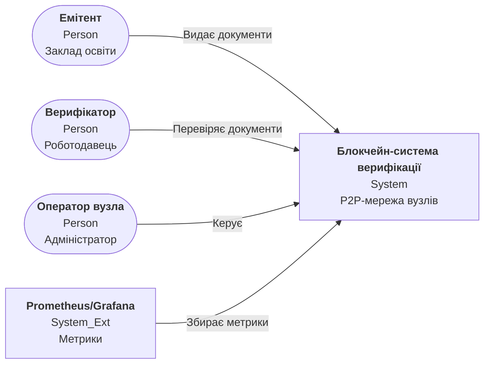
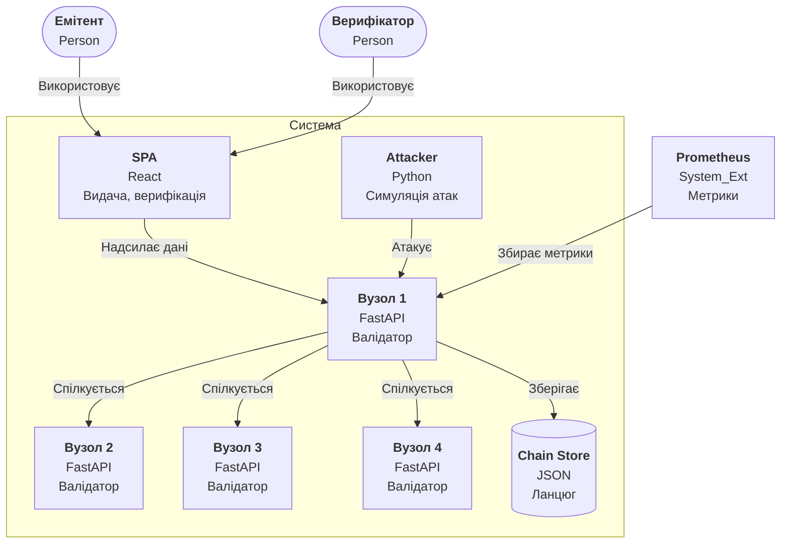

## C4 Level 1 — System Context (чернетка v0.1)

> Зміст чернетки збережено без змін (вузли, зв'язки, підписи); для коректного відображення в Obsidian синтаксис `C4*` замінено на `flowchart`.

## C4 Level 2 — Container (чернетка v0.1)

> Зміст чернетки збережено без змін (вузли, зв'язки, підписи); для коректного відображення в Obsidian синтаксис `C4*` замінено на `flowchart`.

