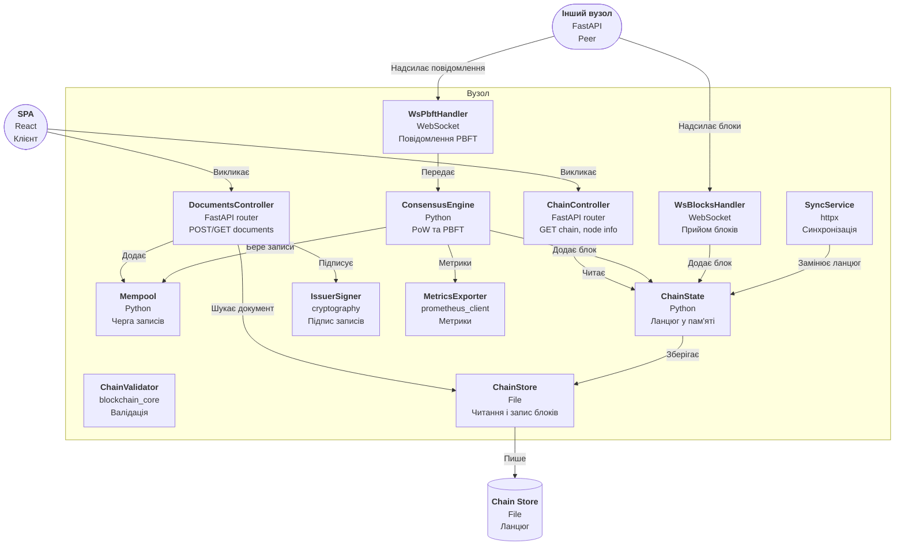

## C4 Level 3 — Component (чернетка v0.1): контейнер «Вузол» (FastAPI, Python 3, asyncio)

> Зміст чернетки збережено без змін (вузли, зв'язки, підписи); для коректного відображення в Obsidian синтаксис `C4*` замінено на `flowchart`.

