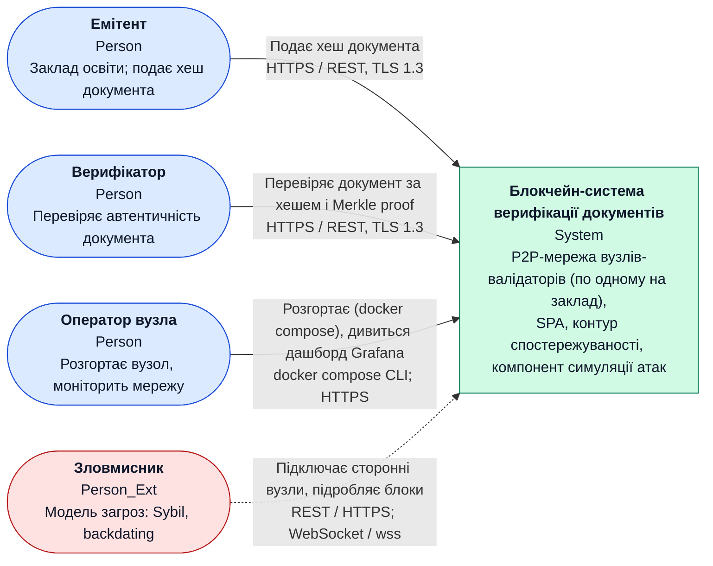
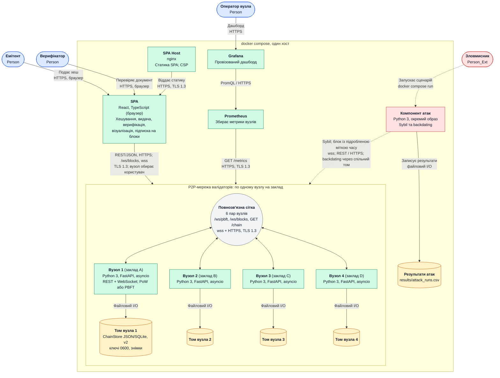
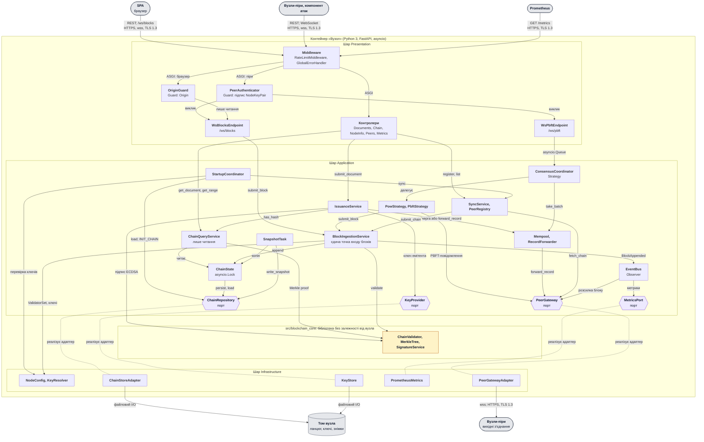
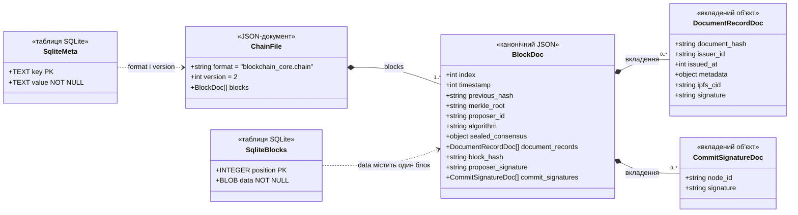
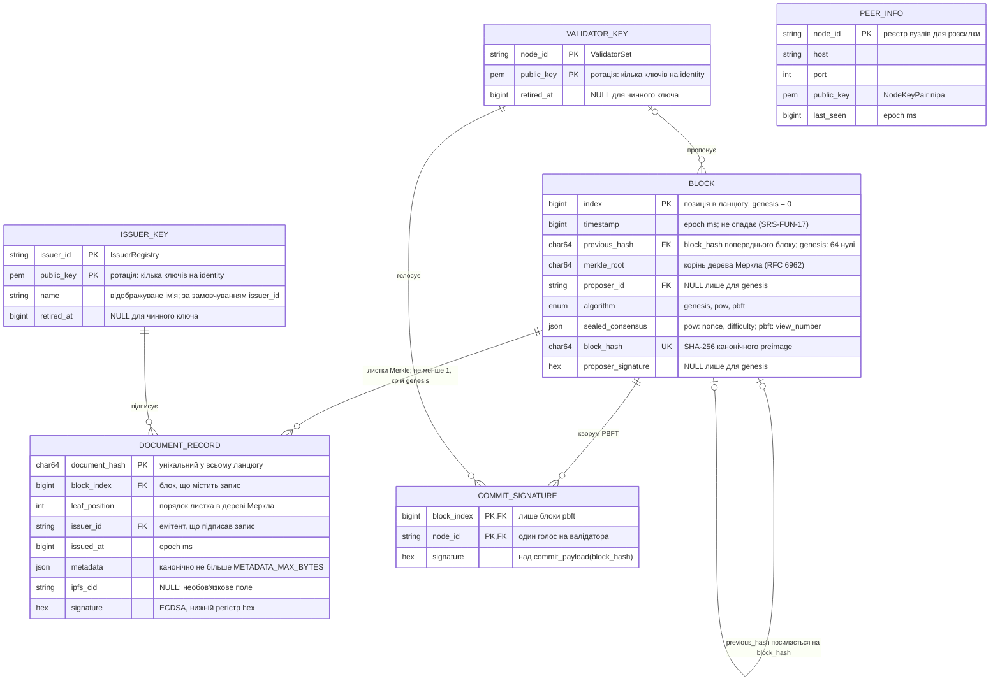
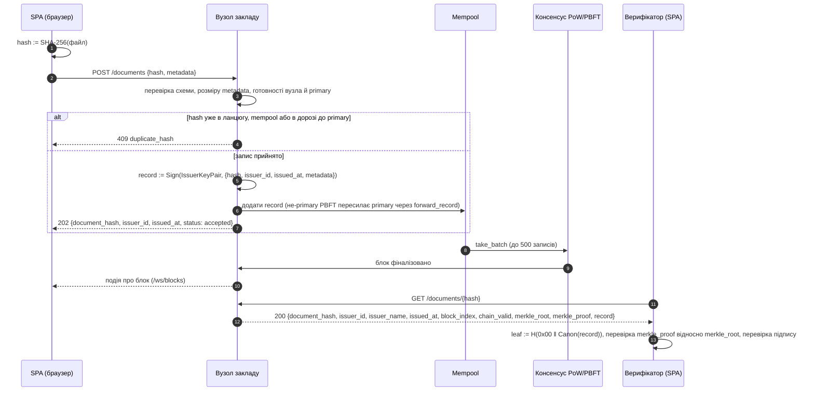
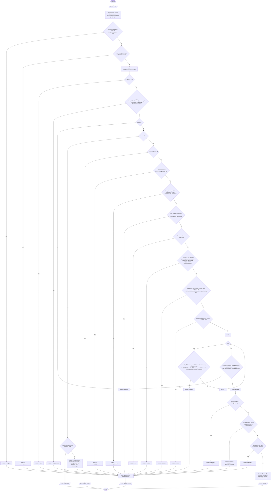
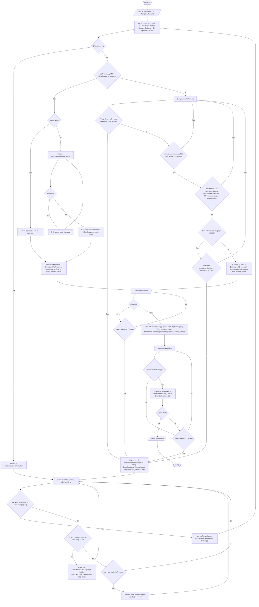
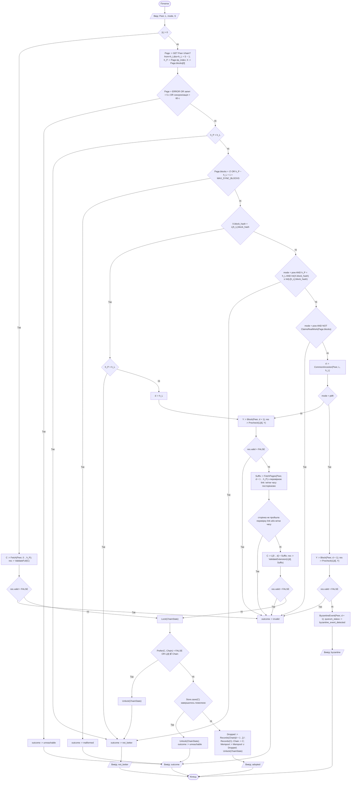

# РОЗДІЛ 2. ПРОЄКТУВАННЯ АРХІТЕКТУРИ СИСТЕМИ

Розділ описує архітектуру системи за моделлю C4 (рівні Context, Container, Component) у форматі Diagrams-as-Code (Mermaid), фіксує ключове архітектурне рішення, а також деталізує нижній рівень: моделі даних (п. 2.4), міжсервісні контракти ([openapi.yaml](api/openapi.yaml), п. 2.5), алгоритми критичних вузлів (п. 2.6) та їх інтеграційну верифікацію (п. 2.7). Усі діаграми трасуються до вимог [SRS](srs.md) та до рішення [ADR-0001](adr/0001-choice-of-technology.md). Посилання виду `SRS-FUN-NN` ведуть до відповідної вимоги у `srs.md`.

## 2.1 Контекстне та контейнерне моделювання системи (C4 Model)

### 2.1.1 Рівень 1 — System Context

**Опис елементів.**

| Елемент | Тип | Роль | Вимоги |
|---|---|---|---|
| Емітент | Person | Подає хеш документа та метадані; підпис формує вузол закладу | [SRS-FUN-08](srs.md#srs-fun-08), [SRS-FUN-32](srs.md#srs-fun-32) |
| Верифікатор | Person | Перевіряє документ за хешем; доказ Merkle перевіряється локально в браузері | [SRS-FUN-38](srs.md#srs-fun-38), [SRS-FUN-52](srs.md#srs-fun-52) |
| Оператор вузла | Person | Запускає `docker compose up`, переглядає метрики | [SRS-FUN-56](srs.md#srs-fun-56), [SRS-FUN-59](srs.md#srs-fun-59) |
| Зловмисник | Person_Ext | Джерело загроз, які імітує компонент атак | [SRS-FUN-61](srs.md#srs-fun-61), [SRS-FUN-62](srs.md#srs-fun-62) |
| Блокчейн-система | System | Єдина система; зовнішніх програмних систем немає (Prometheus і Grafana входять до складу, [SRS п. 1.2](srs.md#12-зовнішнє-середовище)) | [SRS п. 1.1](srs.md#11-призначення-та-межі-scope) |

### 2.1.2 Рівень 2 — Container

**Опис контейнерів.**

| Контейнер | Технологія | Призначення | Вимоги |
|---|---|---|---|
| SPA Host | nginx | Віддає статику SPA, виставляє CSP та `X-Content-Type-Options`; єдиний носій вимоги захисту SPA | [SRS-NFR-SEC-09](srs.md#srs-nfr-sec-09) |
| SPA | React, TypeScript (браузер) | SHA-256 файлу в браузері, видача, верифікація, локальна перевірка Merkle proof, візуалізація, вибір вузла; отримує події про нові блоки каналом `/ws/blocks` (лише читання) і може опитувати `GET /documents/{hash}` | [SRS-FUN-49…55](srs.md#srs-fun-49) |
| Вузол 1…4 | Python 3, FastAPI, asyncio | REST API, WebSocket, консенсус PoW/PBFT, mempool, валідація та зберігання ланцюга, експорт метрик. Один вузол — один заклад (`issuer_id` і `node_id` парні); TLS 1.3 завершується в процесі вузла (uvicorn); rate limiter — ASGI-middleware вузла. Кількість вузлів задається конфігурацією (n ∈ {4, 7, 10}) | [SRS-FUN-21…48](srs.md#srs-fun-21), [SRS-FUN-57](srs.md#srs-fun-57) |
| Том вузла | `ChainStore` (бекенди JSON і SQLite, формат версії 2, блокування single-writer) | Приватне сховище вузла: повна копія ланцюга, ключі `IssuerKeyPair` і `NodeKeyPair` (права 0600), знімки в окремому каталозі. Спільного сховища немає: репліка кожного вузла незалежна | [SRS-FUN-19](srs.md#srs-fun-19), [SRS-FUN-60](srs.md#srs-fun-60), [SRS-NFR-SEC-07](srs.md#srs-nfr-sec-07), [SRS-NFR-INF-03](srs.md#srs-nfr-inf-03) |
| Prometheus | Prometheus | Опитує `GET /metrics` усіх вузлів | [SRS-FUN-47](srs.md#srs-fun-47), [SRS-FUN-59](srs.md#srs-fun-59) |
| Grafana | Grafana | Провізований дашборд без ручного налаштування | [SRS-FUN-59](srs.md#srs-fun-59) |
| Компонент атак | Python 3, окремий образ | Сценарії Sybil та backdating (а, б); не входить до образу вузла | [SRS-FUN-61…64](srs.md#srs-fun-61) |
| Результати атак | CSV у томі | `results/attack_runs.csv` | [SRS-FUN-63](srs.md#srs-fun-63) |

**Міжвузлові канали** (на діаграмі повнозв'язна сітка з 6 пар вузлів показана одним вузлом-шиною; кожна пара використовує всі три канали):

| Канал | Протокол | Призначення | Вимоги |
|---|---|---|---|
| `/ws/pbft` | WebSocket, wss, TLS 1.3 | `pre-prepare`, `prepare`, `commit`, view-change, `forward_record`; повідомлення підписані `NodeKeyPair` | [SRS-FUN-24…27](srs.md#srs-fun-24), [SRS-FUN-37](srs.md#srs-fun-37), [SRS-NFR-SEC-08](srs.md#srs-nfr-sec-08) |
| `/ws/blocks` | WebSocket, wss, TLS 1.3 | Розсилка фіналізованих блоків піру та підписка SPA (лише читання; перевірка `Origin`) | [SRS-FUN-43](srs.md#srs-fun-43) |
| `GET /chain`, `POST /peers/register`, `GET /peers` | REST, HTTPS, TLS 1.3 | Синхронізація ланцюга, реєстр `PeerInfo` | [SRS-FUN-40](srs.md#srs-fun-40), [SRS-FUN-42](srs.md#srs-fun-42), [SRS-FUN-44](srs.md#srs-fun-44) |

**Прийняті архітектурні рішення рівня 2:**

- Централізованого API Gateway, брокера повідомлень, Identity Provider і HSM немає: вони суперечать децентралізації та рішенням [SRS п. 6](srs.md#6-обмеження-припущення-середовище). Транспортне рішення обґрунтовано в [ADR-0001](adr/0001-choice-of-technology.md).
- SPA отримує блоки каналом `WS /ws/blocks` (хук `useBlockStream`), тому вузол перевіряє `Origin` рукостискання та застосовує rate limit до сфери `websocket`; SPA нічого не надсилає каналом, окрім підписки.
- Окремого reverse proxy перед вузлом немає: TLS 1.3, rate limiting і журналювання виконуються в процесі вузла, що узгоджується з відсутністю довіреної сторони між клієнтом і вузлом.
- Джерело сертифікатів — розробницький центр сертифікації, який генерує одноразова службова задача перед стартом (compose init); приватний ключ центру не потрапляє в томи вузлів.
- Генератор навантаження k6 і CI (GitHub Actions) є інструментами верифікації, а не контейнерами системи, і на рівні 2 не показані.

## 2.2 Компонентне моделювання критичного сервісу системи (C4 Component)

Для декомпозиції обрано контейнер **«Вузол»**: він містить консенсус, валідацію ланцюга, мережеву взаємодію та API, тобто основне обчислювальне навантаження системи.

На діаграмі для читабельності поруч показано близькі за роллю компоненти одним блоком (наприклад, `Middleware` = `RateLimitMiddleware` + `GlobalErrorHandler`, `Контролери` = п'ять роутерів); повний перелік і відповідальності наведено в таблиці нижче. Пунктирна лінія «реалізує адаптер» з'єднує порт шару Application з адаптером шару Infrastructure.

**Опис компонентів.**

| Шар | Компонент | Роль, взаємодія, патерн | Вимоги |
|---|---|---|---|
| Presentation | RateLimitMiddleware | Перший елемент конвеєра; ASGI-middleware для `http` і `websocket`; 429 з `Retry-After` | [SRS-NFR-SEC-05](srs.md#srs-nfr-sec-05) |
| Presentation | GlobalErrorHandler | Перетворює доменні виключення на єдиний формат `{"error": {...}}`; журнали JSON без секретів і IP | [SRS-FUN-46](srs.md#srs-fun-46), [SRS-NFR-OBS-01](srs.md#srs-nfr-obs-01), [SRS-NFR-COMP-02](srs.md#srs-nfr-comp-02) |
| Presentation | Контролери (Documents, Chain, NodeInfo, Peers, Metrics) | Лише перетворюють HTTP у виклик сервісу; DTO Pydantic відхиляють зайві поля та надто великі тіла | [SRS-FUN-32…42](srs.md#srs-fun-32), [SRS-NFR-SEC-04](srs.md#srs-nfr-sec-04) |
| Presentation | PeerAuthenticator | Guard перед WebSocket-обробниками піра: підпис `NodeKeyPair` з domain tag, членство у `ValidatorSet` | [SRS-FUN-25](srs.md#srs-fun-25), [SRS-NFR-SEC-08](srs.md#srs-nfr-sec-08) |
| Presentation | OriginGuard | Guard перед `/ws/blocks` для браузерних клієнтів: перевірка `Origin` (CORS не діє на WebSocket); канал для SPA лише для читання | [SRS-FUN-50](srs.md#srs-fun-50) |
| Presentation | WsBlocksEndpoint, WsPbftEndpoint | Приймають автентифіковані повідомлення; не змінюють стан напряму | [SRS-FUN-43](srs.md#srs-fun-43), [SRS-FUN-24](srs.md#srs-fun-24) |
| Application | IssuanceService | Оркестрація видачі: перевірка емітента, підпис, дублікати, mempool або `forward_record` | [SRS-FUN-08](srs.md#srs-fun-08), [SRS-FUN-33](srs.md#srs-fun-33), [SRS-FUN-37](srs.md#srs-fun-37) |
| Application | ChainQueryService | Читальний інтерфейс (ISP): пошук документа, proof, діапазони, стан | [SRS-FUN-38](srs.md#srs-fun-38), [SRS-FUN-40](srs.md#srs-fun-40), [SRS-FUN-41](srs.md#srs-fun-41) |
| Application | BlockIngestionService | Єдиний шлях запису в ланцюг для консенсусу, розсилки та синхронізації; викликає `ChainValidator` до додавання; відхиляє нові блоки з надто далекою майбутньою міткою часу (не застосовується до вже фіналізованих ланцюгів) | [SRS-FUN-45](srs.md#srs-fun-45), [SRS-FUN-44](srs.md#srs-fun-44), [SRS-FUN-65](srs.md#srs-fun-65) |
| Application | ChainState | Єдиний власник ланцюга; запис лише під `asyncio.Lock` (single-writer) | [SRS-FUN-20](srs.md#srs-fun-20) |
| Application | ConsensusCoordinator, PowStrategy, PbftStrategy | Патерн Strategy: третій алгоритм додається без зміни координатора | [SRS-FUN-21…31](srs.md#srs-fun-21) |
| Application | Mempool, RecordForwarder | Черга очікування з відхиленням дублікатів; пересилання primary з відповіддю за `request_id` | [SRS-FUN-33](srs.md#srs-fun-33), [SRS-FUN-37](srs.md#srs-fun-37) |
| Application | StartupCoordinator | Явна ініціалізація (`INIT_CHAIN`), перехресна перевірка ключів, синхронізація з піра перед обслуговуванням | [SRS-FUN-66…68](srs.md#srs-fun-66) |
| Application | SyncService, PeerRegistry | Синхронізація та розв'язання розгалужень; `PeerInfo` не впливає на кворум | [SRS-FUN-44](srs.md#srs-fun-44), [SRS-FUN-26](srs.md#srs-fun-26) |
| Application | EventBus | Observer: подія `BlockAppended` для метрик і розсилки; домен не залежить від Prometheus | [SRS-FUN-43](srs.md#srs-fun-43), [SRS-FUN-47](srs.md#srs-fun-47) |
| Application | SnapshotTask | Копія стану під блокуванням, запис знімка через порт | [SRS-FUN-60](srs.md#srs-fun-60) |
| Application | Порти: ChainRepository, PeerGateway, MetricsPort, KeyProvider | Інверсія залежностей (DIP): сервіси залежать від протоколів, реалізації — в Infrastructure | — |
| Core | ChainValidator, MerkleTree, SignatureService | Бібліотека без імпорту вузла; `ValidatorSet`, `expected_difficulty`, resolver ключів передаються параметрами | [SRS п. 6.1](srs.md#61-обмеження-проєктування), [SRS-FUN-12…18](srs.md#srs-fun-12) |
| Infrastructure | NodeConfig, KeyResolver | Єдине джерело реєстрів; перевірка конфігурації при старті; час-залежний resolver | [SRS-NFR-REL-04](srs.md#srs-nfr-rel-04), [SRS-FUN-10](srs.md#srs-fun-10) |
| Infrastructure | ChainStoreAdapter, KeyStore | `ChainStore` (JSON, SQLite), перевірка форми при завантаженні, ключі з тому з правами 0600 | [SRS-FUN-19](srs.md#srs-fun-19), [SRS-NFR-SEC-07](srs.md#srs-nfr-sec-07) |
| Infrastructure | PeerGatewayAdapter, PrometheusMetrics | Вихідні wss/HTTPS з перепідключенням; реєстр метрик без PII | [SRS-FUN-47](srs.md#srs-fun-47), [SRS-FUN-48](srs.md#srs-fun-48) |

**Інваріанти схеми.**

1. Блок потрапляє в `ChainState` лише через `BlockIngestionService` після `ChainValidator` (три шляхи: консенсус, розсилка, синхронізація).
2. Контролери не мають залежності від сховища; читання проходить через `ChainQueryService`.
3. Залежності спрямовані до портів та до бібліотеки `blockchain_core`; бібліотека не імпортує код вузла.
4. Голоси `commit` підписуються над доменним payload `COMMIT_DOMAIN`, кожен тип повідомлення має власний domain tag; поріг кворуму береться з `ValidatorSet.quorum`.
5. Точки зупинки атак: `RateLimitMiddleware` (флуд), `PeerAuthenticator` (Sybil, підроблені повідомлення), `ChainValidator` (backdating, ін'єкція блоку).

### 2.2.1 Реалізація «як побудовано» (Епіки 1–3, станом на 2026-11-20)

Діаграма та таблиця вище описують **цільову** архітектуру (її не змінено). Нижче наведено відповідність цільових компонентів фактичним модулям `src/`, збудованим в Епіках 1–3, і перелік того, що ще заплановано. Назви класів цільової архітектури, яких у коді немає, є логічними ролями, а не іменами типів.

| Цільовий компонент | Фактична реалізація | Примітка |
|---|---|---|
| ConsensusCoordinator, PowStrategy, PbftStrategy | протокол `ConsensusEngine` (`node/consensus/base.py`); `PowEngine` (`consensus/pow.py`); `PbftEngine` (`consensus/pbft/engine.py`) + `view_change.py`, `rounds.py`, `state_store.py`, `forward.py`, `messages.py` | Окремого координатора немає: `CONSENSUS_MODE` обирає один рушій при старті (`node/context.py`). Патерн Strategy зберігається через спільний протокол. |
| BlockIngestionService | `ValidationGateway` (`node/validation_gateway.py`) + `ChainState.append/replace` | Єдина точка перевірки (`screen`, `screen_candidate`) викликає `ChainValidator` ядра; шляхи запису — консенсус, розсилка, синхронізація. |
| ChainState | `ChainState` (`node/chain_state.py`) | Один `asyncio.Lock`; `replace` перевіряє кандидата поза блокуванням, а під блокуванням повторно застосовує правило вибору (`prefer`) до поточного ланцюга: кандидат, який і далі виграє й чий спільний предок ще довіряється, встановлюється попри додавання блоків за цей час (без `prefer` застарілого кандидата відхиляють за лічильником покоління); збереження виконується через `to_thread`. |
| ChainValidator, MerkleTree, SignatureService | `src/blockchain_core` (`validation.py`, `merkle.py`, `signing.py`, `block.py`, `chain.py`, `genesis.py`, `storage/`) | Без змін; бібліотека не імпортує вузол. |
| KeyResolver, NodeConfig | `node/key_resolver.py`, `node/registries.py` (`valid_from`), `node/config.py` | Часозалежний resolver; реєстри статичні. |
| Кеш стану для `GET /node/info` | `ValidityCache` (`node/validity_cache.py`) | Оновлюється лише подіями append/replace. |
| SyncService | `ChainSync` (`node/sync.py`) | Спільний предок + попередня перевірка першого блоку; опитування валідаторів і до 8 інших пірів; backoff на пір (невалідатори 5…300 с, валідатори ≤ 30 с і без backoff за збоїв зв'язку чи узгодженості). Перед запитом ім'я хоста розв'язується й відхиляється, якщо веде на loopback/link-local/unspecified/multicast (`node/netguard.py`). |
| PeerGatewayAdapter | `PeerConnectionManager` (`network/connection_manager.py`) | Одне автентифіковане з'єднання на пір; ліміти рукостискань і не більше 8 одночасних каналів невалідаторів (`MAX_NON_VALIDATOR_LINKS`); цикли набору закриваються для невідомих id, валідатори не рахуються в `max_dialed`. |
| WsBlocksEndpoint, WsPbftEndpoint | `network/ws_blocks.py`, `network/ws_pbft.py` (приймач) | **Окремого ендпоінту `/ws/pbft` немає:** повідомлення PBFT (`pbft_pre_prepare`, `pbft_prepare`, `pbft_commit`, `pbft_view_change`, `pbft_new_view`) і `forward_record`/`forward_record_reply` мультиплексуються за полем `type` на тому самому автентифікованому з'єднанні `/ws/blocks`. |
| PeerAuthenticator | `peers/attestation.py` (підпис реєстрації, domain `node/peer-register/v1`), автентифікація рукостискання в `connection_manager.py`; `node/admission.py` | Підписана реєстрація з доказом володіння ключем для **кожного** піра. |
| PeerRegistry | `peers/registry.py`, `peers/seed_registration.py`, `api/peers.py` | Ліміт 256, TTL невалідаторів, правила адрес, пагінація. |
| IssuanceService | `api/documents.py` (`POST/GET /documents`) + `Mempool` (`node/mempool.py`) | Окремого сервісу немає; оркестрація в обробнику. |
| Mempool, RecordForwarder | `node/mempool.py`; `ForwardService`, `RecordForwarder` (`node/forwarding.py`); `WsRecordForwarder`, `RecordIntake`, `ForwardChannel` (`consensus/pbft/forward.py`) | Виявлення цензури: запис, не фіналізований за три таймаути раунду, ініціює зміну виду. |
| ChainQueryService | `api/chain.py`, `api/documents.py`, `api/node_info.py` (читання через `ChainState`) | Окремого сервісу немає. |
| GlobalErrorHandler | `node/errors.py`; `node/body_limit.py` (413 `payload_too_large`) | Єдиний формат помилок. |
| StartupCoordinator | `node/context.py` (`build_node_context`, `BootError`) і фонове завдання «go-live» у `node/main.py` | Завантаження, перевірка, обмежена початкова синхронізація, потім `serving = true`. |
| EventBus | відсутній | Оновлення `ValidityCache` і розсилка блоків викликаються безпосередньо з `ChainState`/рушіїв. |
| Метрики консенсусу | `node/metrics.py`, `api/metrics.py` (`GET /metrics/consensus`) | JSON-ендпоінт Епіку 3; не Prometheus. |

**Ще не реалізовано (заплановано на пізніші епіки):** підписка SPA на `/ws/blocks` з перевіркою `Origin` (`OriginGuard`; Епік 4), `RateLimitMiddleware` (Слайс 31a), експорт Prometheus `GET /metrics` і `PrometheusMetrics` (Слайс 30), TLS 1.3 (Слайси 32a/32b), `SnapshotTask` і знімки ланцюга (Слайс 33b), Docker-образ і compose-мережа (Слайс 19). Ці компоненти лишаються в цільовій діаграмі вище.

**Зміни, внесені аудитом перед Слайсом 19 (hardening pass H1):** підписана реєстрація пірів з доказом володіння ключем; перевірка спільного предка при розгалуженні замість повної валідації з генезису; ліміти тіл запитів, рукостискань і кадрів; обмеження `MAX_BLOCK_RECORDS = 500`; відмова при старті PBFT без файлу стану; стійкий (sticky) статус Byzantine переживає перезапуск. **Хвиля D (підсумковий перегляд безпеки):** `ChainState.replace` повторно застосовує правило вибору під блокуванням (збіжність PoW-вузла на меншій гілці); повторна реєстрація id з `ValidatorSet` після ротації ключа замінює збережений ключ, `stale_registration` за відставання понад `MAX_FUTURE_SKEW_MS`, а старіша реєстрація в межах цього допуску приймається лише як продовження TTL з тією самою адресою (хвиля E); Byzantine-події дедуплікуються за `(reason, offender)`, а `BYZANTINE_RESET_ON_BOOT=<токен>` (одноразовий дайджест: скидання лише якщо значення дорівнює токену, який вузол пише в WARNING на запуску) — єдиний спосіб зняти липкий статус; backoff валідатора ≤ 30 с; захист вихідних адрес `netguard` (залишковий ризик DNS rebinding — у фабриці TLS-клієнта Епіку 6); `MAX_NON_VALIDATOR_LINKS` = 8; необов'язковий `revoked` у реєстрах (ключ не розв'язується в жодний момент часу, власний відкликаний ключ блокує запуск); WARNING на кожному запуску з `PBFT_ALLOW_MISSING_STATE`; запуск застосовує верхню межу часу до збереженого ланцюга (`timestamp_in_future`). **Хвиля E:** порядок реєстрацій піра (`issued_at` не зменшується); перевірка підписів gossip поза циклом подій; окремі обмежені пули DNS (2 для валідаторів, 4 для інших, таймаут 5 с, кеш 30 с) і для завантаження ланцюга; обмежені лічильники прапорців (LRU 1024) і журнал Byzantine-подій (перша подія порушника, ≤ 4 на порушника, ≤ 32 порушників, ≤ 128 подій); `netguard` відхиляє також 0.0.0.0/8, `::/96` і `fd00:ec2::254`; `MAX_CONCURRENT_HANDSHAKES` = 8; посторінкова перевірка зв'язку/часу суфікса під час завантаження та backoff валідатора 5 с з ескалацією до 30 с після 3 збоїв поспіль; ERROR при запуску з вказівкою на регламент відкликання ключів (`docs/README.md`). Прийнято без змін коду: перший ключ з `valid_from = null` чинний з початку (для ідентичностей, доданих після genesis, задавати `valid_from`); перевірка власної адреси — порівняння рядків (аліас не ловиться, безпечно); на Windows bind-mount показує права 0777, тож Slice 19 має використати іменовані томи або копіювати ключі з `chmod 0600`. Свідомо не змінено: підписи пропозиції блоку та записів не мають domain tag (інакше змінилися б хеші); інші підписані повідомлення мають власні domain tag.

## 2.3 Документування архітектурних рішень (Architecture Decision Records)

| ADR | Назва | Статус |
|---|---|---|
| [ADR-0001](adr/0001-choice-of-technology.md) | Вибір транспорту між вузлами: REST + WebSocket замість брокера повідомлень і gRPC | Approved |

Каталог: [adr/](adr/).

## 2.4 Проєктування та документування моделей даних

Шар збереження даних системи побудовано навколо append-only реєстру блоків, який кожен вузол веде самостійно (приватний том, [SRS-NFR-INF-03](srs.md#srs-nfr-inf-03)). Зовнішня СУБД не застосовується: контракт `ChainStore` має два взаємозамінні бекенди (JSON-файл і SQLite) з однаковим канонічним кодуванням блоку ([SRS-FUN-19](srs.md#srs-fun-19), [SRS п. 6.1](srs.md#61-обмеження-проєктування)). Тому модель даних подано на двох рівнях: **фізичному** (що записано у файл — п. 2.4.1) та **логічному** (сутності, ключі й зв'язки, на які спираються валідація, API та алгоритми — п. 2.4.2). Логічна модель є реляційним поданням тих самих даних і використовується для аналізу цілісності (3NF) та узгодження з [контрактом API](#25-специфікація-міжсервісних-контрактів-api).

### 2.4.1 Фізична модель збереження

Рішення щодо стратегії **вкладення (Embedding)** та **посилань (Referencing)**:

- Записи документів і голоси `commit` **вкладено** в документ блоку, а не винесено в окремі колекції. Обґрунтування: цілісність записів гарантує `merkle_root` блоку, а голоси перевіряються разом із блоком (`validate_chain`); читання блоку виконується однією операцією, без об'єднань (JOIN). Розмір документа обмежено зверху: до `MAX_BLOCK_RECORDS` = 500 записів у блоці ([SRS-FUN-14](srs.md#srs-fun-14), [SRS-FUN-36](srs.md#srs-fun-36)), `metadata` ≤ `METADATA_MAX_BYTES` (за замовчуванням 1024 байти канонічного кодування, [SRS-NFR-SEC-04](srs.md#srs-nfr-sec-04)), `commit_signatures` ≤ `len(members)`.
- Зв'язок між блоками виконано **посиланням** — через `previous_hash`. Посилання на ключі (`issuer_id`, `proposer_id`, `node_id`) вказують на статичні реєстри, що завантажуються з конфігурації; вбудовувати ключі в блок не можна, оскільки ключ підлягає ротації та відкликанню ([SRS-FUN-10](srs.md#srs-fun-10)).
- Усі числові значення — цілі (JSON не допускає `float`; завантаження сховища відхиляє дробові числа, дублікати ключів і надмірну вкладеність). Мітки часу — Unix epoch у мілісекундах.
- Допоміжні файли поруч зі сховищем: `<path>.lock` (блокування single-writer), `<path>.pbft-state.json` (підписані голоси, блокування, відкритий голос view-change та номер view PBFT; реалізовано в Slice 18), PEM-файли ключів `IssuerKeyPair` і `NodeKeyPair` (права 0600) та каталог знімків ([SRS-FUN-60](srs.md#srs-fun-60)).

### 2.4.2 Логічна модель (ERD)

Сутність `PEER_INFO` свідомо не має зв'язків: реєстр піров слугує лише для розсилки й структурно відокремлений від `ValidatorSet`, щоб зростання кількості піров не змінювало `n`, `f` і кворум ([SRS-FUN-26](srs.md#srs-fun-26)). Реєстри `ISSUER_KEY` і `VALIDATOR_KEY` статичні, завантажуються з конфігурації під час старту й не змінюються під час роботи вузла. Посилання `DOCUMENT_RECORD.issuer_id` і `BLOCK.proposer_id` розв'язуються за часом: ключ обирається за `retired_at` відносно `block.timestamp` (time-aware resolver), тому зовнішнього ключа в класичному розумінні не існує — перевірку виконує `ChainValidator`, а не СУБД.

**Нормалізація (3NF).** Атрибути кожної сутності залежать лише від її ключа: `block_hash` і `merkle_root` — похідні від полів блоку та записів, але зберігаються як атрибути свідомо (це криптографічні зобов'язання, перерахунок яких є метою валідації, а не оптимізацією); `issuer_name` не дублюється в записах і підставляється з `ISSUER_KEY.name` під час відповіді API; поле `name` не підписується й не входить до перевірки підпису ([SRS-FUN-70](srs.md#srs-fun-70)). Аномалій оновлення та видалення немає за побудовою: реєстр append-only, операцій зміни й видалення в інтерфейсі `ChainStore` не передбачено ([SRS-FUN-19](srs.md#srs-fun-19)).

### 2.4.3 Специфікація сутностей

**BLOCK** — блок ланцюга (документ у `ChainFile.blocks[]` або рядок `SqliteBlocks`).

| Поле | Тип (JSON / логічний) | Обмеження | Опис |
|---|---|---|---|
| `index` | int / bigint | PK; дорівнює позиції в ланцюгу; genesis = 0 | Порядковий номер блоку; у валідації порівнюється з позицією |
| `timestamp` | int / bigint | ≥ `timestamp` попереднього блоку ([SRS-FUN-17](srs.md#srs-fun-17)); для нового блоку ≤ `now` + `MAX_FUTURE_SKEW_MS` ([SRS-FUN-65](srs.md#srs-fun-65)) | Unix epoch, мс; цілий тип, оскільки `float` заборонено форматом сховища |
| `previous_hash` | string / char(64) | `^[0-9a-f]{64}$`; дорівнює `block_hash` попереднього блоку; для genesis — 64 нулі | Зв'язок ланцюга (hash-linking) |
| `merkle_root` | string / char(64) | `^[0-9a-f]{64}$`; для genesis — SHA-256 порожнього рядка | Корінь дерева Меркла над `document_records` |
| `proposer_id` | string / varchar(64) \| null | `node_id` з `ValidatorSet`; `null` лише для genesis | Ідентичність пропозера; входить у хеш |
| `algorithm` | string / enum | `genesis` \| `pow` \| `pbft`; у ланцюзі лише один режим | Алгоритм консенсусу; блок чужого режиму відхиляється ([SRS-FUN-29](srs.md#srs-fun-29)) |
| `sealed_consensus` | object / json | `pow`: `{nonce, difficulty}`, `difficulty` ∈ [1, 256] і дорівнює `expected_difficulty`; `pbft`: `{view_number}`; genesis: `{}` | Параметри консенсусу, що входять у хеш |
| `document_records` | array | 1…500 елементів (`MAX_BLOCK_RECORDS`; genesis — 0); не входить у хеш, цілісність — через `merkle_root` | Вкладені записи документів |
| `block_hash` | string / char(64) | `^[0-9a-f]{64}$`; UK; дорівнює SHA-256 канонічного preimage | Ідентифікатор блоку |
| `proposer_signature` | string / hex \| null | ECDSA P-256 за `NodeKeyPair` над preimage; low-S; нижній регістр | Підпис пропозера; `null` лише для genesis |
| `commit_signatures` | array | PBFT: ≥ `quorum` = ⌊(n + f)/2⌋ + 1 різних членів, довжина ≤ `len(members)`; PoW: порожній | Голоси `commit` над `commit_payload(block_hash)` |

**DOCUMENT_RECORD** — підписаний запис документа (елемент `block.document_records[]`).

| Поле | Тип | Обмеження | Опис |
|---|---|---|---|
| `document_hash` | string / char(64) | PK; `^[0-9a-f]{64}$`; унікальний у блоці (ядро) і в усьому ланцюгу та mempool (вузол, [SRS-FUN-33](srs.md#srs-fun-33)) | SHA-256 вмісту документа, обчислений у браузері |
| `block_index` | int / bigint | FK → `BLOCK.index`; логічне поле (у JSON визначається вкладенням) | Блок, що містить запис |
| `leaf_position` | int | 0 ≤ значення < `len(document_records)`; логічне поле (визначається позицією в масиві) | Позиція листка; використовується для Merkle proof |
| `issuer_id` | string / varchar(64) | Присутній в `IssuerRegistry`; інакше запис відхиляється (403) | Заклад-емітент |
| `issued_at` | int / bigint | epoch мс; задає вузол під час підписання | Час видачі; визначає чинний ключ емітента |
| `metadata` | object / json | Канонічне кодування ≤ `METADATA_MAX_BYTES` (1024); без `float` | Мінімальні метадані документа |
| `ipfs_cid` | string \| null | Необов'язкове; за базовим обсягом `null` | Посилання на файл у IPFS (опційне розширення) |
| `signature` | string / hex | ECDSA P-256 за `IssuerKeyPair` над `unsigned_dict`; low-S; нижній регістр hex | Підпис запису, виконаний вузлом закладу |

**COMMIT_SIGNATURE** — голос `commit` (лише блоки `pbft`).

| Поле | Тип | Обмеження | Опис |
|---|---|---|---|
| `block_index` | int | PK, FK → `BLOCK.index`; логічне поле | Блок, за який голосують |
| `node_id` | string | PK, FK → `ValidatorSet`; не більше одного голосу від члена | Валідатор |
| `signature` | string / hex | Над `{domain: "blockchain_core/pbft-commit/v1", block_hash}`, не над голим preimage | Голос `commit` |

**ISSUER_KEY / VALIDATOR_KEY** — записи `IssuerRegistry` і `ValidatorSet` (файли JSON конфігурації, [SRS-FUN-10](srs.md#srs-fun-10)).

| Поле | Тип | Обмеження | Опис |
|---|---|---|---|
| `issuer_id` / `node_id` | string | PK (разом із `public_key`); непорожній | Ідентичність |
| `public_key` | string / PEM | Допустимий тип і розмір ключа | Відкритий ключ; для однієї ідентичності допускається кілька записів (ротація) |
| `retired_at` | int \| null | Не більше одного запису без `retired_at` на ідентичність | Момент виведення ключа з обігу; старі блоки перевіряються історичним ключем |
| `name` (лише `ISSUER_KEY`) | string | За замовчуванням = `issuer_id`; не підписується | Відображуване ім'я закладу (`issuer_name` у API) |

**PEER_INFO** — запис реєстру піров (у пам'яті процесу, не персистентний).

| Поле | Тип | Обмеження | Опис |
|---|---|---|---|
| `node_id` | string | PK; `^[A-Za-z0-9._-]{1,64}$` | Ідентичність піра; повторна реєстрація з іншим ключем — 409 |
| `host` | string | `^[A-Za-z0-9.-]{1,253}$` | Адреса піра |
| `port` | int | 1…65535 | Порт |
| `public_key` | string / PEM | ≤ 2048 символів; допустимий тип ключа | Ключ `NodeKeyPair` піра |
| `last_seen` | int \| null | epoch мс | Остання активність |

### 2.4.4 План індексування та продуктивність

Файловий реєстр не має вторинних індексів СУБД, тому індекси будуються як структури в пам'яті під час завантаження ланцюга (`restore_chain`, складність O(n)) і підтримуються інкрементально під блокуванням `ChainState`.

| Індекс | Структура | Ключ → значення | Запит, який прискорює | Складність |
|---|---|---|---|---|
| `blocks.position` | B-дерево (PRIMARY KEY SQLite; номер елемента в JSON-масиві) | `index` → блок | `GET /chain?from&to`, синхронізація діапазонами | O(log n + k), k ≤ `MAX_PAGE_SIZE` (100) |
| `by_document_hash` | Хеш-таблиця | `document_hash` → (`block_index`, `leaf_position`) | `GET /documents/{hash}`, перевірка дубліката при `POST /documents` (409) | O(1) |
| `by_block_hash` | Хеш-таблиця | `block_hash` → `index` | Виявлення спільного предка під час синхронізації й розгалужень | O(1) |
| `mempool_hashes` | Хеш-множина | `document_hash` | Відхилення дубліката до фіналізації блоку | O(1) |
| `validity_cache` | Один запис | `{tip_index, chain_valid, first_invalid_index, quorum_status}` + `liveness`, журнал `byzantine_events` | `GET /node/info` без перерахунку | O(1) |

Індекси за `issuer_id`, `issued_at` та вмістом `metadata` не будуються: запитів за цими полями немає в [SRS](srs.md) (усі читання — за хешем документа або діапазоном блоків). GIN, векторні та повнотекстові індекси не застосовуються, оскільки пошук за змістом документа відсутній.

**Обґрунтування типів.**

- Хеші — рядок hex довжиною рівно 64 символи в нижньому регістрі (SHA-256): однозначне канонічне кодування для підпису, шаблон `^[0-9a-f]{64}$` перевіряється на вході API та при завантаженні сховища; двійкове подання (32 байти) дало б економію ≈ 50 % місця, але ускладнило б канонічний JSON і порівняння з відповідями API.
- Підписи — рядок hex у нижньому регістрі, лише low-S (єдине валідне кодування кожного підпису); це унеможливлює повторне кодування підпису ретранслятором.
- Мітки часу — ціле число мс (не рядок ISO 8601): не залежить від часового поясу, порівнюється як число, сумісне з обмеженням «лише цілі» у форматі сховища.
- `metadata` — об'єкт JSON з верхньою межею за розміром канонічного кодування, а не довільний `TEXT`: обмеження розміру одночасно захищає від DoS і гарантує, що запис вміститься в блок.

### 2.4.5 Відповідність вимогам цілісності та службовим полям

| Службовий механізм | Рішення | Обґрунтування |
|---|---|---|
| `created_at` | Поле `timestamp` блоку та `issued_at` запису | Окремий `created_at` дублював би підписане значення |
| `updated_at`, `deleted_at` (soft delete) | Не застосовуються | Реєстр append-only; зміна або видалення блоку — це порушення цілісності, що виявляє `ChainValidator`; відкликання документів поза обсягом ([SRS п. 6.2](srs.md#62-припущення-та-рішення-щодо-обсягу)) |
| Оптимістичне блокування (`version`) | Single-writer: `asyncio.Lock` у `ChainState` та файлове блокування `<path>.lock` | Один записувач на вузол; конфлікти версій неможливі за конструкцією |
| Версіонування схеми | `CHAIN_FORMAT_VERSION = 2` у файлі та в таблиці `meta` | Завантаження файлу іншої версії відхиляється як пошкодження |
| Журнал аудиту змін статусу | Сам ланцюг; перехід `pending` → `finalized` визначається присутністю хеша в mempool або в блоці | Окремого журналу не потрібно; статус не зберігається, а виводиться |
| Цілісність посилань | `previous_hash`, `proposer_id`, `issuer_id`, `node_id` перевіряються `ChainValidator` та реєстрами | Зовнішні ключі СУБД відсутні; цілісність забезпечує код валідації |
| Відновлення після збою | Шапка формату перевіряється при завантаженні; зміст — повною валідацією; ланцюг, що не пройшов її, відновлюється без права продовження | [SRS-FUN-20](srs.md#srs-fun-20) |

## 2.5 Специфікація міжсервісних контрактів (API)

Контракт зафіксовано за підходом API-First у форматі OpenAPI 3.0.3 (YAML): **[openapi.yaml](api/openapi.yaml)**. Формат REST/OpenAPI обрано, а gRPC Protobuf відхилено рішенням [ADR-0001](adr/0001-choice-of-technology.md): браузерна SPA не може викликати gRPC без додаткового проксі, а канонічне кодування підписів (JSON) не повинно дублюватися другим форматом серіалізації. Контракт можна використати для генерації клієнтського SDK SPA та для перевірки відповідностей вузла інструментом Schemathesis ([SRS п. 7](srs.md#7-verification-criteria-критерії-верифікації)).

### 2.5.1 Взаємодіючі контейнери

Інтерфейс реалізовано між контейнерами рівня 2 моделі C4 ([діаграма](#diagram-level2)):

| Клієнт | Сервер | Операції контракту | Призначення |
|---|---|---|---|
| SPA (React, TypeScript) | Вузол (FastAPI) | `POST /documents`, `GET /documents/{hash}`, `GET /chain`, `GET /node/info` | Видача, верифікація, візуалізація ланцюга |
| Вузол | Вузол | `GET /chain`, `POST /peers/register`, `GET /peers` | Синхронізація ланцюга та реєстр піров |
| Docker healthcheck, Prometheus | Вузол | `GET /node/info` (healthcheck); `GET /metrics/consensus` (метрики консенсусу, JSON, поза цим контрактом) | Контроль стану |

Канали `WS /ws/blocks` і `WS /ws/pbft` не описуються в OpenAPI (специфікація не охоплює WebSocket): склад повідомлень і підписи визначено в [SRS-FUN-24…27](srs.md#srs-fun-24), [SRS-FUN-43](srs.md#srs-fun-43) та [ADR-0001](adr/0001-choice-of-technology.md).

### 2.5.2 Операції контракту

| Операція | Успіх | Помилки | Вимоги |
|---|---|---|---|
| `POST /documents` | 202 `IssueAccepted` | 403, 409, 413, 422, 429, 500, 502, 503 | [SRS-FUN-32…34](srs.md#srs-fun-32), [SRS-NFR-SEC-03](srs.md#srs-nfr-sec-03) |
| `GET /documents/{hash}` | 200 `DocumentVerification` | 404, 422, 429, 500 | [SRS-FUN-38, 39](srs.md#srs-fun-38) |
| `GET /chain?from&to` | 200 `ChainPage` | 422, 429, 500 | [SRS-FUN-40](srs.md#srs-fun-40), [SRS-FUN-44](srs.md#srs-fun-44) |
| `GET /node/info` | 200 `NodeInfo` | 429, 500 | [SRS-FUN-41](srs.md#srs-fun-41), [SRS-FUN-58](srs.md#srs-fun-58) |
| `GET /peers` | 200 `PeerList` | 429, 500 | [SRS-FUN-42](srs.md#srs-fun-42) |
| `POST /peers/register` | 200 `PeerList` | 403, 409, 422, 429, 500, 503 | [SRS-FUN-42](srs.md#srs-fun-42) |

Основний сценарій (видача й верифікація) наведено на діаграмі послідовності.

### 2.5.3 Автентифікація та безпека

Модель автентифікації контракту відрізняється від типової для REST із JWT, і це рішення прийнято свідомо в ЛР №5 ([SRS п. 6.2](srs.md#62-припущення-та-рішення-щодо-обсягу)):

- **Облікових записів, OAuth2/OIDC і JWT немає.** Токен користувача нічого б не доводив: верифікатор не зобов'язаний довіряти вузлу, оскільки перевіряє Merkle proof і підпис запису локально. У `openapi.yaml` тому задано `security: []` для кожної операції, а `components.securitySchemes` не оголошено (оголошення схеми, яку жодна операція не використовує, вводило б в оману).
- **Автентичність емітента** забезпечує ECDSA P-256 підпис `DocumentRecord`: вузол підписує запис ключем `IssuerKeyPair` власного закладу (приватний ключ не залишає том вузла й не потрапляє в SPA), а перевірка виконується за `IssuerRegistry` ([SRS-FUN-08, 09](srs.md#srs-fun-08)). Тіло запиту `POST /documents` із полем `signature` відхиляється (422): клієнт не може подати вже підписаний запис.
- **Ідентичність вузла** підтверджується підписом `NodeKeyPair` над доменним payload на каналах WebSocket ([SRS-FUN-25](srs.md#srs-fun-25)); REST-реєстрація піра теж підписана (`issued_at`, `signature`, домен `node/peer-register/v1`): ідентичність валідатора підписується ключем, який `ValidatorSet` тримає для нього, інша ідентичність — ключем, що реєструється; реєстр піров не впливає на кворум.
- **Транспорт:** TLS 1.3 завершується в процесі вузла (HTTPS, `wss`), mTLS не вимагається ([SRS-NFR-SEC-08](srs.md#srs-nfr-sec-08)).
- **Обмеження частоти:** 100 запитів за 60 с на IP за замовчуванням; перевищення — 429 із заголовком `Retry-After` ([SRS-NFR-SEC-05](srs.md#srs-nfr-sec-05)); SPA повторює запит з урахуванням `Retry-After` ([SRS-FUN-55](srs.md#srs-fun-55)). Вимога специфікована, у вузлі ще не реалізована (п. 2.7.2, M6).
- **Код 401 не використовується:** автентифікації користувача немає. Підпис емітента перевіряється на боці вузла, тому емітент, невідомий primary, отримує 403 `unregistered_issuer`, а не 401.

### 2.5.4 Каталог помилок

Усі помилки мають єдину оболонку `{"error": {"code", "message", "details"}}` ([SRS-FUN-46](srs.md#srs-fun-46)); поле `code` — закритий перелік.

| HTTP | `code` | Умова | Операції |
|---|---|---|---|
| 403 | `unregistered_issuer` | Primary не знає емітента пересланого запису | `POST /documents` |
| 403 | `registration_unauthenticated` | Реєстрацію не підписано, вона прострочена або підпис не збігається | `POST /peers/register` |
| 404 | `not_found` | Хеш відсутній у фіналізованих блоках (невідомий або ще в mempool) | `GET /documents/{hash}` |
| 405 | `method_not_allowed` | Недопустимий метод | усі |
| 409 | `duplicate_hash` | Хеш уже у фіналізованому блоці, у mempool або в дорозі до primary | `POST /documents` |
| 409 | `peer_key_mismatch` | `node_id` уже зареєстровано з іншим ключем | `POST /peers/register` |
| 409 | `stale_registration` | Для піра вже є новіша реєстрація | `POST /peers/register` |
| 413 | `payload_too_large` | Тіло перевищує ліміт шляху (`POST /documents` — 4 × `METADATA_MAX_BYTES` + 1024 байт, `POST /peers/register` — 8 КіБ, решта — 16 КіБ) | `POST /documents`, `POST /peers/register` |
| 422 | `validation_error` | Хеш поза шаблоном `^[0-9a-f]{64}$`, зайві поля (у т. ч. `signature`), повторений ключ JSON, надто глибока вкладеність, неприйнятний ключ | усі з параметрами |
| 422 | `invalid_metadata`, `metadata_too_large` | `metadata` не кодується канонічно або перевищує `METADATA_MAX_BYTES` | `POST /documents` |
| 422 | `invalid_record` | Primary відхилив пересланий запис | `POST /documents` |
| 422 | `invalid_range` | `to` менше за `from` | `GET /chain` |
| 422 | `invalid_peer_address` | Адреса не маршрутизується (loopback, link-local, multicast, власна адреса вузла) | `POST /peers/register` |
| 429 | `rate_limited` | Перевищено ліміт запитів; заголовок `Retry-After` (специфіковано, не реалізовано) | усі |
| 500 | `internal_error` | Необроблена помилка; текст винятку не розкривається | усі |
| 500 | `chain_integrity_error` | Хеш трапляється більше ніж в одному блоці або не рівно один раз у своєму блоці; `details` містить індекси блоків | `GET /documents/{hash}` |
| 502 | `not_validator`, `auth_failed` | Primary відхилив канал пересилання | `POST /documents` |
| 502 | `forward_protocol_error` | Primary відповів поза закритим набором відповідей | `POST /documents` |
| 503 | `peer_registry_full` | Реєстр піров заповнений | `POST /peers/register` |
| 503 | `not_ready`, `chain_invalid`, `no_primary`, `not_primary`, `mempool_full`, `forward_timeout`, `forward_unavailable` | Вузол стартує або зупиняється; локальний ланцюг недійсний; primary не визначено (view-change); вузол не primary; mempool заповнений; primary не відповів або недоступний. Усі з заголовком `Retry-After` | `POST /documents` |

Додатково застосовується код `http_error` (інші помилки HTTP рівня фреймворку).

### 2.5.5 Інваріанти контракту

1. `hash`, `block_hash`, `merkle_root`, `previous_hash` відповідають шаблону `^[0-9a-f]{64}$`; підписи — hex у нижньому регістрі.
2. Усі мітки часу — цілі числа мілісекунд Unix epoch (`int64`); `float` у `metadata` відхиляється.
3. `issuer_name` — не підписане поле відображення; перевірка підпису використовує лише `record`. `chain_valid` — вердикт кешу валідності вузла: верифікатор не повинен довіряти знайденому запису, якщо воно `false`.
4. Сторінка `GET /chain` містить не більше `MAX_PAGE_SIZE` блоків (за замовчуванням 100; значення задає конфігурація вузла), діапазон включний з обох боків; початковий індекс вище за tip дає порожню сторінку (`to_index = null`), а не 404.
5. `merkle_proof` містить не більше 9 кроків (дерево з ≤ 500 листків); крок `promoted` не має `sibling_hash`.
6. Відповідь `POST /documents` повертається до фіналізації блоку; єдиним джерелом істини про фіналізацію є `GET /documents/{hash}` (200) або подія `/ws/blocks`.

## 2.6 Моделювання логіки критичних вузлів системи

Обрано три алгоритми, у яких зосереджена координаційна та обчислювальна складність вузла: **A** — валідація й додавання блоку (єдина точка запису в ланцюг для розсилки й консенсусу), **B** — фіналізація блоку за PBFT із заміною primary (view-change), **C** — синхронізація й розв'язання розгалужень. Схеми побудовано за ДСТУ: термінатор — «стадіон», процес — прямокутник, рішення — ромб, ввід/вивід — паралелограм.

**Правила запису.** Присвоєння — лише `:=`; знак `=` — лише оператор порівняння в умовах; умови поєднуються `AND`, `OR`, `NOT`; елементи масивів — `Block[i]`, `Records[k]`, `C[i]`; `|X|` — потужність колекції; `⌊x⌋` — ціла частина; `Int(H)` — ціле значення хеша. Параметри з конфігурації вузла позначено ідентифікаторами SRS (`MAX_FUTURE_SKEW_MS`, `MAX_PAGE_SIZE`, `PBFT_ROUND_TIMEOUT_S`, `STARTUP_SYNC_TIMEOUT_S`).

### 2.6.1 Алгоритм A — валідація й додавання блоку (`ValidationGateway` + `ChainState.append`)

Єдиний шлях запису в `ChainState` для блоків, отриманих розсилкою (`/ws/blocks`) та фіналізованих консенсусом ([SRS-FUN-45](srs.md#srs-fun-45), [SRS-FUN-12…18](srs.md#srs-fun-12), [SRS-FUN-65](srs.md#srs-fun-65)). Ланцюг, отриманий синхронізацією, проходить той самий чекліст через `ChainState.replace` (алгоритм C). Алгоритм відповідає `ValidationGateway.screen`, чекліст ядра — `validate_extension`, запис — `ChainState.append` (`src/node/validation_gateway.py`, `src/node/chain_state.py`, `src/blockchain_core/validation.py`).

**Вхід:** блок `B` від піра; режим вузла `mode` ∈ {`pow`, `pbft`}; `T` — поточний tip. **Вихід:** `ACCEPT`, `DUPLICATE`, `NEEDS_SYNC` або `REJECT(reason)`, де `reason` ∈ {`unsigned`, `unknown_proposer`, `hash`, `bad_signature`, `structural`, `conflict`, `timestamp_in_future`, `timestamp_too_old`, `link`, `difficulty`, `quorum`, `merkle`, `signature`, `duplicate_document`, `store_error`}.

**Покрокове формулювання.**

1. `T := Chain[tip]`; `now := Clock.now()`; `m := |B.document_records|`; `q := ⌊(n + f) / 2⌋ + 1`.
2. Підпис пропозера: якщо `B.proposer_signature` порожній — `unsigned`; якщо ключ `NodeKey(B.proposer_id, B.timestamp)` не визначено (пропозер не входить до `ValidatorSet` і не має чинного ключа) — `unknown_proposer`.
3. `H := SHA256(Canon(Preimage(B)))`: `block_hash` не входить до підпису пропозера, тому його перераховують, інакше копія з підміненим хешем сприймалася б як дублікат; `H ≠ B.block_hash` — `hash`; недійсний підпис — `bad_signature` (підроблений `proposer_id` не вважається еквівокацією).
4. Положення блоку: `B.index < 1` — `structural`; `B.index ≤ T.index` — збіг `block_hash` з наявним блоком дає `DUPLICATE` (ідемпотентність), розбіжність — `conflict` (перший фіналізований виграє; якщо той самий пропозер підписав два різні блоки на одній висоті, це Byzantine-подія); `B.index > T.index + 1` — `NEEDS_SYNC`.
5. Мітка часу: `B.timestamp > now + MAX_FUTURE_SKEW_MS` — `timestamp_in_future`; для `pow` додатково `B.timestamp < now − MAX_FUTURE_SKEW_MS` — `timestamp_too_old` (запобігає заднім числом підписаним блокам до відкликання ключа); блоки PBFT нижньою межею не обмежені, бо блок, перенесений у наступний view, зберігає початкову мітку ([SRS-FUN-65](srs.md#srs-fun-65)).
6. Чекліст ядра в порядку [SRS-FUN-18](srs.md#srs-fun-18): форма блоку (типи полів, `m ≤ MAX_BLOCK_RECORDS` = 500) → `link` → `difficulty` (лише `pow`: `Int(H) < 2^(256 − expected_difficulty)`) → `quorum` (лише `pbft`) → `merkle` → `signature`. Кворум і складність перевіряються до Merkle й підписів записів, бо потребують однієї операції на учасника, і блок без більшості не змушує вузол виконувати до 500 перевірок підписів записів. Блок іншого алгоритму, ніж режим вузла, не проходить `difficulty` (вузол PoW) або `quorum` (вузол PBFT).
7. Цикл для `k := 0, …, m − 1`: підпис `B.document_records[k]` перевіряється за ключем, чинним на `B.timestamp`; відсутній ключ дорівнює відмові (fail closed). Цикл обмежений константою 500.
8. Структурні перевірки: `B.index = T.index + 1`, `B.timestamp ≥ T.timestamp`, `1 ≤ m`, відсутність дубліката `document_hash` у блоці.
9. Під `Lock(ChainState)` повторно перевіряються `B.previous_hash = Chain[tip].block_hash` (tip міг змінитися), унікальність `document_hash` у всьому ланцюгу (`duplicate_document` — правило рівня вузла, яке ядро не знає) і, у потоці-виконавці, весь чекліст ядра. `Store.save` — точка фіксації: лише після успіху оновлюються `Chain`, індекс документів і mempool.

**Крайові випадки.** Помилка запису не змінює `Chain` (`store_error`); відхилений блок не розповсюджується далі ([SRS-FUN-45](srs.md#srs-fun-45)); конкурентні додавання серіалізуються єдиним `asyncio.Lock`; повторна доставка того самого блоку не змінює стан (`DUPLICATE`); два різні блоки різних майнерів на одній висоті в PoW — звичайна вилка, а не помилка пропозера; у PBFT конфлікт двох блоків одного пропозера фіксується як Byzantine-подія (`byzantine_events`, `quorum_status = byzantine_event_detected`).

### 2.6.2 Алгоритм B — фіналізація блоку PBFT із заміною primary

Алгоритм виконує кожен валідатор для однієї висоти `seq := T.index + 1` ([SRS-FUN-24…27](srs.md#srs-fun-24), [SRS-FUN-31](srs.md#srs-fun-31)); відповідає `PbftEngine` (`src/node/consensus/pbft/engine.py`, `rounds.py`, `view_change.py`). Поріг `q` береться з `ValidatorSet.quorum` і не перераховується окремо; кожне повідомлення підписується `NodeKeyPair` над payload із власним domain tag ([SRS-FUN-25](srs.md#srs-fun-25)). Підпис голосу `commit` не залежить від view, тому голос лишається чинним у наступних view.

**Вхід:** номер view `v`; `Validators` — відсортований список членів `ValidatorSet` з ключем, чинним на `T.timestamp`; `f`; `q := ⌊(n + f) / 2⌋ + 1`; `Mempool`; `T_round := PBFT_ROUND_TIMEOUT_S`; `lock` — підготовлений блок із сертифікатом, якщо є. **Вихід:** `finalized(B)`; за відсутності кворуму — стан `crash_fault_quorum_loss` без нового раунду.

**Покрокове формулювання.**

1. `seq := T.index + 1`; `primary := Validators[v mod n]` (список відсортований, склад визначають ключі, чинні на `T.timestamp`, тому всі вузли на одному tip обчислюють однаковий primary); якщо `|Validators| < q`, primary не визначено, вузол позначає `liveness := crash_fault_quorum_loss` і новий раунд не розпочинає.
2. Primary, якщо view-change не відкрито: при `lock ≠ NULL` повторно пропонує `lock.block` разом із сертифікатом (підготовлений блок не замінюється іншим); інакше формує `B := BuildCandidate(Batch, v)` із `Mempool.take(max_batch)` (`max_batch ≤ MAX_BLOCK_RECORDS`; при `|Batch| = 0` очікує подію mempool, без активного опитування), підписує й розсилає `PrePrepare`. Один view і одна висота дають не більше однієї пропозиції.
3. Не-primary: `PrePrepare` ігнорується, якщо відправник не primary або підпис недійсний. Якщо вузол має `lock` на іншому блоці, нового блока без сертифіката вищого view він не підтримує й чекає на таймаут. Кандидат проходить `ScreenCandidate` (чекліст ядра без кворуму, обидві межі мітки часу, унікальність `document_hash`); тимчасові причини (`timestamp_in_future`, `timestamp_too_old`) ігноруються, будь-яка інша відмова призводить до негайного голосу за view-change. Прийнятий кандидат отримує `Prepare`; таймер раунду `opened` стартує від прийнятого кандидата, а не від самого голосу.
4. Голос `PrePrepare` primary вже є його голосом `Prepare`: `|Prep|` рахує primary один раз неявно, окремого `Prepare` від primary немає. Коли `|Prep| ≥ q`, вузол будує сертифікат, ставить `lock := (cert, B)`, зберігає стан (`<CHAIN_PATH>.pbft-state.json`) і розсилає `Commit` над `commit_payload(B.block_hash)`.
5. Голоси `Commit` враховуються лише після того, як сам вузол підготував блок: самі лише голоси `Commit` блок не фіналізують. При `|ValidCommits(Com)| ≥ q` — `B.commit_signatures := ValidCommits(Com)`; `ChainState.append(B)` виконує алгоритм A (включно з перевіркою кворуму). Відмова `append` лишає раунд відкритим до наступного повтору або таймауту.
6. View-change виникає за чотирьох причин: таймаут раунду (`now − opened ≥ T_round`), недоступність primary довше за `T_round`, недійсна пропозиція і цензура (записи, які primary прийняв від цього вузла через `forward_record`, не фіналізовано за `3 × T_round`). Голос `ViewChange(target, seq, lock)` зберігається на диск **до** відправлення. Вузол доєднується до view `w > v`, якщо за неї проголосували щонайменше `f + 1` інших валідаторів (один Byzantine-вузол не може змусити змінити view).
7. Нова view встановлюється, коли `q` валідаторів проголосували за view не нижче `target`; доказом служить повідомлення `NewView` із `q` підписаними голосами, яке надсилається й вузлу, що відстав. Збережений `lock` переноситься до нового primary; блок, що міг бути фіналізований десь, повторно пропонується без змін.

**Крайові випадки.** Падіння primary — спливає `T_round`, ініціюється `ViewChange`, новий primary обчислюється за `v mod n`; порожній mempool — очікування без таймера раунду; два різні блоки одного пропозера на одній висоті або два підписи одного члена за різні блоки в одному (view, seq) — Byzantine-подія (`byzantine_events`), перший голос лишається врахованим; голос від вузла поза `ValidatorSet` або подвійний голос не збільшує `|Prep|` та `|ValidCommits|` (рахуються різні члени, по одному ключу); відсутність кворуму не призводить до нескінченного циклу з навантаженням на CPU: вузол очікує подій і повторює голос раз на `T_round`; `liveness` (`healthy`, `view_change_in_progress`, `crash_fault_quorum_loss`) показується в `GET /node/info` окремо від липкого статусу Byzantine-події. Параметри: `PBFT_ROUND_TIMEOUT_S` (5 с, мінімум 0,05), `MAX_BLOCK_RECORDS` = 500 ([SRS-FUN-27](srs.md#srs-fun-27), [SRS-FUN-14](srs.md#srs-fun-14)).

### 2.6.3 Алгоритм C — синхронізація та розв'язання розгалужень

Виконується під час старту вузла (до обслуговування запитів, [SRS-FUN-68](srs.md#srs-fun-68)) і періодично з піром ([SRS-FUN-44](srs.md#srs-fun-44), [SRS-FUN-30](srs.md#srs-fun-30)); відповідає `ChainSync` (`src/node/sync.py`) і `ChainState.replace`. Вузол не завантажує ланцюг піра цілком: він перевіряє лише те, що відрізняється від довіреного локального ланцюга.

**Вхід:** `Peer`; довірений локальний ланцюг `L` (висота `h_L`, `L[i]` — блок `i`); `mode`; `S := MAX_PAGE_SIZE`. Константи реалізації: `MAX_SYNC_BLOCKS` = 100 000, таймаут запиту 5 с, ліміт одного піра 60 с. **Вихід:** `adopted`, `not_better`, `byzantine`, `invalid`, `malformed` або `unreachable`.

**Покрокове формулювання.**

1. Якщо жоден локальний блок не довіряється (навіть genesis), вузол завантажує ланцюг піра й перевіряє його від genesis повністю (`ValidateFull`); це єдиний випадок повної перевірки.
2. Інакше запитується одна сторінка, що починається з власного tip: `GET /chain?from=h_L&to=h_L + S − 1`. Помилка мережі або перевищення часу — `unreachable`; пір позаду (`h_P < h_L`) — `not_better`; порожня сторінка за `h_P ≥ h_L` або висота, що перевищує `MAX_SYNC_BLOCKS`, — `malformed` (запобігає нескінченному завантаженню з хибного піра).
3. Якщо перший блок сторінки збігається з нашим tip — це розширення без розходження: за `h_P = h_L` ланцюг той самий (`not_better`), інакше розходження немає й `d := h_L`.
4. Якщо блоки різні, виконується пошук спільного предка `CommonAncestor`: бінарний пошук одноблоковими запитами, далі одна сторінка — `O(log n)` малих запитів замість завантаження ланцюга. Для `pow` до цього перевіряються рівна висота з нижчим хешем (`not_better`, без завантаження) і наявність реальної роботи в оголошених блоках (`ClaimsRealWork`: хеш збігається й задовольняє ціль складності).
5. Для `pbft` розходження — це два фіналізовані блоки на одній висоті, чого не може бути серед чесних вузлів, тому tie-break не застосовується. Перший блок піра після предка `Y` перевіряється повним чеклістом проти **нашого** блока `L[d]` (включно з кворумом), щоб непідписана підробка не викликала хибної тривоги. Якщо `Y` коректний, фіксується Byzantine-подія (`quorum_status = byzantine_event_detected`, липкий статус), ланцюг не змінюється, решта ланцюга не завантажується.
6. Для розширення (`pow` — після спільного предка, `pbft` — лише строге продовження) перший блок суфікса проходить `Precheck`, решта сторінок завантажується з посторінковою перевіркою `link` і межі мітки часу; суфікс перевіряється як розширення від довіреного `L[d]` (`ValidateExtension`: чекліст алгоритму A, `timestamp_in_future`, унікальність `document_hash` у ланцюгу). Повна перевірка від genesis не потрібна, бо основа — власний довірений блок.
7. Під `Lock(ChainState)` правило вибору перераховується для актуального ланцюга: `pow` — довший ланцюг, а за рівної довжини — менший `Int(block_hash)` кінцевого блока (детермінований tie-break, [SRS-FUN-30](srs.md#srs-fun-30)); `pbft` — вища фіналізована висота; `L[d]` має й далі належати поточному ланцюгу. Далі `Store.save(C)`; лише після успіху `Chain := C`, а записи відкинутих блоків, яких немає в `C`, повертаються до `Mempool` (прийняті записи не втрачаються).

**Крайові випадки.** Пір повернув порожній ланцюг чи ланцюг іншого genesis — відмова без змін; недійсний ланцюг (підроблений підпис, брак кворуму) — `invalid` (пір для не-валідатора отримує експоненційний backoff 5…300 с, для валідатора — не більше 30 с, і не за збої зв'язку чи узгодженості); пір коротший за `L` — `not_better`; помилка запису — локальний ланцюг не змінюється; адреси loopback, link-local, multicast і метаданих хмари відкидаються до запиту; за раунд опитуються всі валідатори з адресою та до 8 інших пірів (ротація). Кількість запитів, розмір ланцюга (`MAX_SYNC_BLOCKS`) і час (5 с на запит, 60 с на піра) обмежені, тож цикл завершується за скінченну кількість кроків. Стартова синхронізація повторює раунди до підтвердження ланцюга хоча б одного валідатора або до `STARTUP_SYNC_TIMEOUT_S` (10 с); після цього вузол обслуговує локальний ланцюг і далі синхронізується у фоні.

## 2.7 Інтеграційний аудит та верифікація цілісності доменів

Інтеграційний аудит перевіряє узгодженість трьох артефактів, створених у ЛР №6: моделі даних (п. [2.4](#24-проєктування-та-документування-моделей-даних)), API-контракту ([openapi.yaml](api/openapi.yaml), п. [2.5](#25-специфікація-міжсервісних-контрактів-api)) і алгоритмів (п. [2.6](#26-моделювання-логіки-критичних-вузлів-системи)), а також їх відповідність вимогам [SRS](srs.md) і реалізації. Реалізацію перевірено за гілкою `feat/blockchain-core-scaffold` (коміт `6a3641b`, Епіки 1–3: ядро, вузол, PoW, PBFT із view-change, синхронізація, `POST /documents`). Хронологія аудиту та звіти аудитора зафіксовано в [AI Insights](../F2_Diploma_Yakymiv_DR/05-AI-Insights.md) (розділ «ЛР №6»).

### 2.7.1 Виконані перевірки

| № | Перевірка | Метод | Результат |
|---|---|---|---|
| 1 | Структура `openapi.yaml`: усі `$ref` розв'язуються, `operationId` унікальні, шляхові параметри оголошені, кожна схема використана, `required` ⊆ `properties` | Скрипт на `PyYAML` | Помилок немає |
| 2 | Імена й обов'язковість полів схем контракту (`NodeInfo` — 15 полів, `ChainPage`, `IssueRequest`, `IssueAccepted`, `DocumentVerification`, `RegisterRequest`, `PeerOut`, `ProofStep`) проти моделей Pydantic гілки | Скрипт: розбір `ast` вихідного коду гілки та порівняння з `openapi.yaml` | Розбіжностей немає (після виправлень M1) |
| 3 | Коди помилок: застосовані в `src/node` гілки й оголошені в контракті | Скрипт, пошук `ApiError(...)`, `_retryable(...)`, `RegistrationError(...)` | Усі 28 кодів коду є в контракті; у контракті є ще `rate_limited` (не реалізовано, M6); `timestamp_in_future` — внутрішня причина відхилення блока, не код HTTP |
| 4 | Порядок перевірок алгоритму A відносно `ValidationGateway.screen`, `validate_extension` і SRS-FUN-18 | Читання коду | Збіг після виправлення M2: форма → `hash` → `link` → `difficulty` → `quorum` → `merkle` → `signature` → структурні |
| 5 | Алгоритм B відносно `PbftEngine`, `ViewChangeState`, `count_prepare_votes` | Читання коду | Збіг після виправлення M3 |
| 6 | Алгоритм C відносно `ChainSync`, `pow_prefers`, `pbft_prefers`, `ChainState.replace` | Читання коду | Збіг після виправлення M4 |
| 7 | Рендеринг 9 діаграм Mermaid (C4, ERD, `classDiagram`, послідовність, 3 блок-схеми) | Mermaid 11.4.0, браузер Microsoft Edge (Playwright) | Усі відрендерено без помилок |
| 8 | Відповідність типів між шарами (таблиця 2.7.3) | Аналіз | Конфліктів немає |
| 9 | Відповідність сутностей алгоритмів схемі даних і API (таблиця 2.7.4) | Аналіз | Конфліктів немає |

### 2.7.2 Виявлені розбіжності та їх усунення

Перша версія контракту й алгоритмів була складена за SRS і плановою документацією, коли код консенсусу, синхронізації та `POST /documents` ще не потрапив у цю гілку. Після звіряння з реалізацією виявлено розбіжності M1–M4; джерелом істини для реалізованої поведінки прийнято код і SRS 1.3.x гілки, тому виправлено артефакти ЛР №6.

| № | Розбіжність | Рівень | Усунення |
|---|---|---|---|
| M0 | `PeerOut` у контракті будувався через `allOf` над закритою схемою (`additionalProperties: false`), що забороняло б `last_seen`; `;` у повідомленні діаграми послідовності порушувало синтаксис Mermaid | Дефект артефакту | Виправлено: `PeerOut` описано окремою схемою, `;` замінено на `,` |
| M1 | Контракт відрізнявся від реалізованих відповідей: коди `duplicate_document`, `issuer_not_registered`, `node_not_ready` замість `duplicate_hash`, `unregistered_issuer`, `not_ready` (і сім повторюваних 503); `IssueAccepted.status = pending` замість `accepted`; `DocumentVerification` із вкладеним `record` і `block_hash` замість плоскої відповіді `{document_hash, issuer_id, issuer_name, issued_at, block_index, chain_valid, merkle_root, merkle_proof, record}`; `NodeInfo` без `liveness`, `byzantine_events`, `peer_health`, `serving`; значення `quorum_status` `degraded`, `safety_violation` замість `byzantine_event_detected`, `view_change_in_progress`, `crash_fault_quorum_loss`; реєстрація піра без `issued_at` і `signature`; відсутні коди 502, `chain_integrity_error`, `registration_unauthenticated`, `stale_registration`, `invalid_peer_address`, `peer_registry_full` | Дефект артефакту | Виправлено в `openapi.yaml` і п. 2.5; скрипт із п. 2.7.1 (№ 2, 3) підтверджує збіг |
| M2 | Алгоритм A: кворум PBFT стояв після підписів і структурних перевірок; не було кроків `unsigned`, `unknown_proposer`, `conflict`, `DUPLICATE`, `NEEDS_SYNC`, `timestamp_too_old`, унікальності `document_hash` у ланцюгу; ліміт записів у блоці 256 замість `MAX_BLOCK_RECORDS` = 500 | Дефект артефакту | Алгоритм і ліміти переписано за `ValidationGateway`, `validate_extension`, `ChainState.append` |
| M3 | Алгоритм B: окремий `Prepare` primary, ліміт `PBFT_MAX_VIEW_RETRIES` і стан `degraded`, `tries`; не враховано, що `PrePrepare` primary є його голосом `Prepare`, `lock` і сертифікат підготовленого блока, `NewView`, причини view-change (недоступність primary, цензура, недійсна пропозиція) | Дефект артефакту | Алгоритм переписано за `PbftEngine`; параметри, яких немає в коді, прибрано |
| M4 | Алгоритм C: завантаження всього ланцюга піра, повтори `SYNC_MAX_RETRIES`, `SYNC_FETCH_TIMEOUT_S`, загальна перевірка `ValidateChain`; фактично вузол перевіряє лише розходження: запит від свого tip, бінарний пошук спільного предка, `Precheck` першого блока, перевірка розширення від довіреного блока | Дефект артефакту | Алгоритм переписано за `ChainSync`; параметри замінено реальними константами |
| M5 | У чернетці SRS v1.4 (п. 6.4) було введено параметри `PBFT_MAX_VIEW_RETRIES`, `SYNC_*`, значення `degraded`, `safety_violation`, яких немає в реалізації; гілка вже містить узгоджений SRS 1.3.1–1.3.3 | Дефект артефакту | Зміни `srs.md` скасовано; джерелом параметрів вважається SRS 1.3.3 гілки (SRS-FUN-27, 41, 44, 46, 65, 68 і перелік змінних конфігурації) |
| M6 | `RATE_LIMIT_PER_MIN`, відповідь 429 `rate_limited` ([SRS-NFR-SEC-05](srs.md#srs-nfr-sec-05)) описані в контракті, але в коді відсутні | Відставання коду від контракту | Контракт збережено (вимога SRS); реалізацію внесено до умов передачі в Розділ 3 |
| M7 | [SRS-FUN-36](srs.md#srs-fun-36) вимагає блок до 256 записів; реалізація (`DEFAULT_MAX_BATCH`) формує до `MAX_BLOCK_RECORDS` = 500 | Розбіжність вимоги й коду | Артефакти ЛР №6 описують реалізовану межу 500; SRS 1.3.1 гілки це відзначає; значення 256 потребує рішення (змінити вимогу чи обмежити `max_batch`) |

### 2.7.3 Узгодженість типів між шарами

| Атрибут | Модель даних (2.4) | API-контракт (2.5) | Алгоритми (2.6) | Висновок |
|---|---|---|---|---|
| `document_hash` / `hash` | char(64), hex нижнього регістру | `Hash64`, `^[0-9a-f]{64}$` (запит — `hash`, відповідь — `document_hash`) | `HasDuplicateHash`, `FinalizedHashes`, `Mempool` за тим самим ключем | Збіг |
| `issued_at`, `timestamp`, `last_seen` | bigint, epoch мс | `EpochMillis`, `integer/int64` | `B.timestamp`, `now`, `MAX_FUTURE_SKEW_MS` у мс | Збіг |
| `issuer_id`, `node_id`, `proposer_id` | string, до 64 символів | `Identifier`, `^[A-Za-z0-9._-]{1,64}$`; `proposer_id` nullable | `IssuerKey(...)`, `NodeKey(...)` | Збіг |
| `signature`, `proposer_signature` | hex нижнього регістру, low-S | `SignatureHex` | `VerifyECDSA(...)` | Збіг |
| `sealed_consensus` | json (`nonce`, `difficulty` / `view_number`) | `object` | `B.sealed_consensus.difficulty` (A), `view_number` = `v` (B) | Збіг |
| `commit_signatures[]` | `{node_id, signature}` | `CommitSignature` | `CountDistinctValidCommits(...)`, `ValidCommits(Com)`, `q` | Збіг |
| `document_records` у блоці | 1…500 (genesis — 0) | `maxItems: 500` | `m ≤ MAX_BLOCK_RECORDS` | Збіг після M2 |
| `metadata` | json, ≤ `METADATA_MAX_BYTES` | `Metadata`, об'єкт; 422 `metadata_too_large` | не використовується в алгоритмах | Збіг |
| Merkle proof | вираховується з `document_records` | `merkle_proof[]`, `ProofStep {position, sibling_hash}`; ≤ 9 кроків | `MerkleRoot(B.document_records)` | Збіг (500 листків дають 9 рівнів) |
| `quorum_status`, `liveness` | `validity_cache` | `enum` із 5 значень і `enum` із 3 значень | `liveness := crash_fault_quorum_loss` (B), `quorum_status := byzantine_event_detected` (C) | Збіг після M1 |
| Статус запису | виводиться (mempool або блок) | `IssueAccepted.status = accepted`; `GET` 200 = finalized | `Mempool := Mempool \ B.document_records` після `ACCEPT` | Збіг |

### 2.7.4 Узгодженість алгоритмів із даними та API

| Сутність алгоритму | Де закладена |
|---|---|
| `B.document_records[k]` (A) | Вкладений масив `BLOCK.document_records`; схема `Block` у контракті; індекс `k` — позиція листка (`leaf_position`) |
| `Validators`, `q`, `f` (B) | `VALIDATOR_KEY`, `ValidatorSet.quorum`; `n`, `f` у `NodeInfo` |
| `lock`, `ViewChange`, `Persist(...)` (B) | `<path>.pbft-state.json` (п. 2.4.1) |
| `Mempool.take(max_batch)` (B), `Mempool := Mempool ∪ Dropped` (C) | Структура в пам'яті; індекс `mempool_hashes` (п. 2.4.4); метрики консенсусу `GET /metrics/consensus` |
| `GET Peer /chain?from&to`, `Page.tip_index`, `Page.blocks` (C) | `GET /chain`, схема `ChainPage` (`tip_index`, `blocks`, `to_index`, `truncated`) |
| `L[i].block_hash`, `FinalizedHashes` (A, C) | `BLOCK.block_hash`; індекси `by_block_hash`, `by_document_hash` |
| `ByzantineEvent`, `quorum_status` (A, B, C) | `NodeInfo.byzantine_events`, `NodeInfo.quorum_status`; журнал подій зберігається у файлі стану PBFT |
| `reason` / `outcome` (A, C) | Значення `reason` збігаються з [SRS-FUN-18](srs.md#srs-fun-18) і причинами рівня вузла (`unsigned`, `unknown_proposer`, `conflict`, `timestamp_in_future`, `timestamp_too_old`, `duplicate_document`) |

### 2.7.5 Production Readiness Report

**Висновок.** Блокерів (Showstoppers), які призвели б до розбіжності між шарами або до помилок інтеграції, не виявлено. Контракт, алгоритми й модель даних звірено з реалізацією (гілка `feat/blockchain-core-scaffold`, коміт `6a3641b`) і між собою. Розбіжності M0–M5 усунено в артефактах ЛР №6; M6 і M7 є відставанням реалізації від вимог SRS і потребують рішення під час Розділу 3.

| Область | Стан | Примітка |
|---|---|---|
| Модель даних | Готово до реалізації | 3NF для логічної моделі; індекси визначено; службові поля обґрунтовано |
| API-контракт | Готово до генерації SDK та Schemathesis | 6 операцій, 29 кодів помилок, єдина оболонка помилок; поля схем збігаються з моделями Pydantic; модель автентифікації задокументовано |
| Алгоритми | Відповідають реалізації | Цикли обмежено (500 записів, `MAX_SYNC_BLOCKS`, 5 с на запит, 60 с на піра, подієве очікування); відсутність кворуму не призводить до busy-loop |
| Трасованість | Готово | Кожен елемент посилається на SRS-FUN/NFR; значення параметрів беруться з SRS 1.3.3 гілки |

**Умови передачі в Розділ 3 (трасоване відставання реалізації).**

| № | Завдання реалізації | Розбіжність | Вимога |
|---|---|---|---|
| 1 | Реалізувати `RateLimitMiddleware` (`rate_limited`, `Retry-After`) | M6 | SRS-NFR-SEC-05 |
| 2 | Узгодити ліміт пакета: 256 за вимогою чи 500 у реалізації | M7 | SRS-FUN-36, SRS-FUN-14 |
| 3 | Додати перевірку контракту Schemathesis у CI | — | SRS п. 7 |

**Обмеження аудиту.** Аудит виконано за специфікаціями й кодом на 2026-11-23. Алгоритми B і C звірено читанням коду, а не виконанням сценаріїв: прогін тестів вузла (PBFT view-change, синхронізація з форками) не входив до цієї лабораторної роботи. Схеми контракту звірено скриптом з моделями Pydantic, поведінку кінцевих точок під навантаженням не перевірено.
