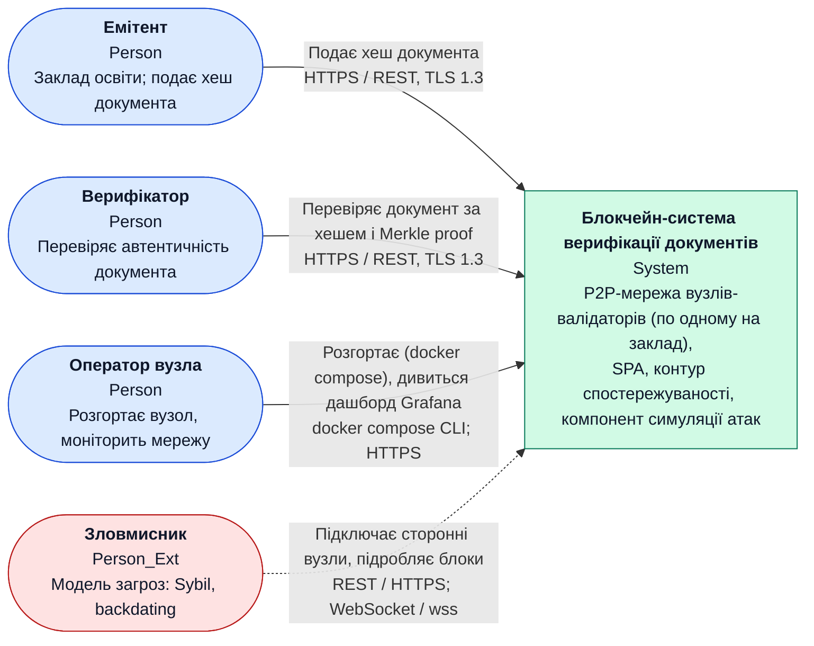
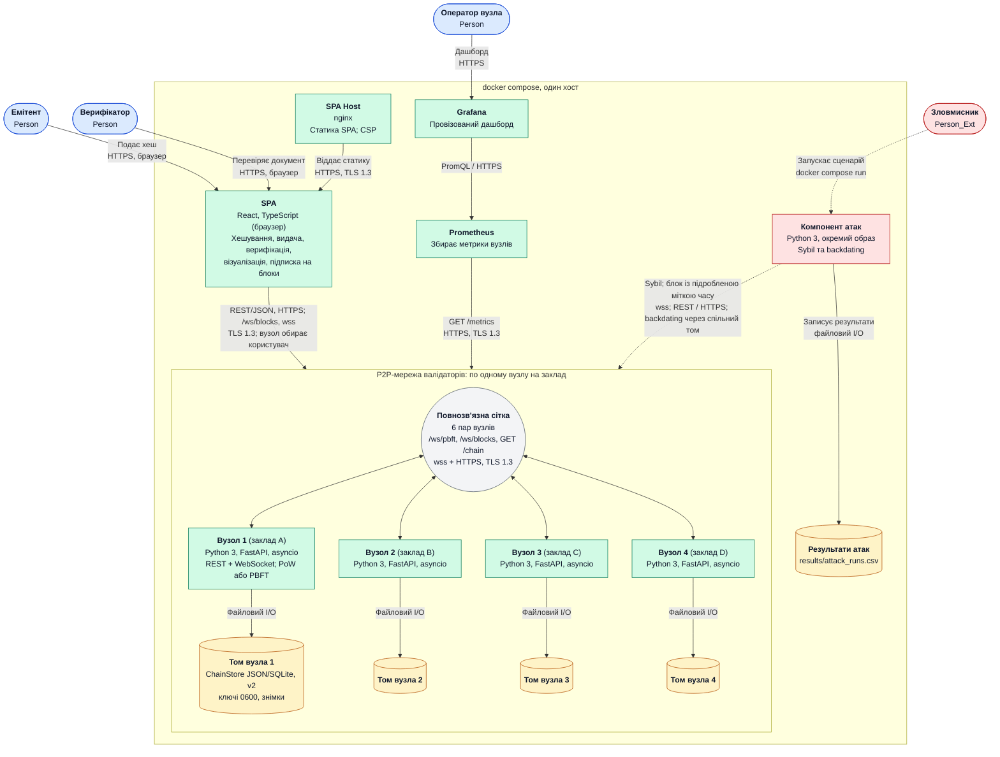
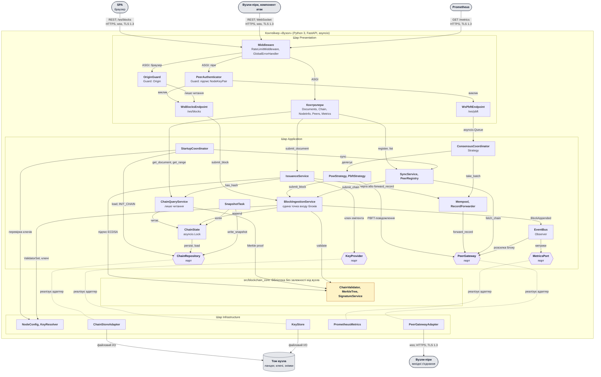

# РОЗДІЛ 2. ПРОЄКТУВАННЯ АРХІТЕКТУРИ СИСТЕМИ

Розділ описує архітектуру системи за моделлю C4 (рівні Context, Container, Component) у форматі Diagrams-as-Code (Mermaid) і фіксує ключове архітектурне рішення. Усі діаграми трасуються до вимог [SRS](srs.md) та до рішення [ADR-0001](adr/0001-choice-of-technology.md). Посилання виду `SRS-FUN-NN` ведуть до відповідної вимоги у `srs.md`.

## 2.1 Контекстне та контейнерне моделювання системи (C4 Model)

### 2.1.1 Рівень 1 — System Context

**Опис елементів.**

| Елемент | Тип | Роль | Вимоги |
|---|---|---|---|
| Емітент | Person | Подає хеш документа та метадані; підпис формує вузол закладу | [SRS-FUN-08](srs.md#srs-fun-08), [SRS-FUN-32](srs.md#srs-fun-32) |
| Верифікатор | Person | Перевіряє документ за хешем; доказ Merkle перевіряється локально в браузері | [SRS-FUN-38](srs.md#srs-fun-38), [SRS-FUN-52](srs.md#srs-fun-52) |
| Оператор вузла | Person | Запускає `docker compose up`, переглядає метрики | [SRS-FUN-56](srs.md#srs-fun-56), [SRS-FUN-59](srs.md#srs-fun-59) |
| Зловмисник | Person_Ext | Джерело загроз, які імітує компонент атак | [SRS-FUN-61](srs.md#srs-fun-61), [SRS-FUN-62](srs.md#srs-fun-62) |
| Блокчейн-система | System | Єдина система; зовнішніх програмних систем немає (Prometheus і Grafana входять до складу, [SRS п. 1.2](srs.md#12-зовнішнє-середовище)) | [SRS п. 1.1](srs.md#11-призначення-та-межі-scope) |

### 2.1.2 Рівень 2 — Container

**Опис контейнерів.**

| Контейнер | Технологія | Призначення | Вимоги |
|---|---|---|---|
| SPA Host | nginx | Віддає статику SPA, виставляє CSP та `X-Content-Type-Options`; єдиний носій вимоги захисту SPA | [SRS-NFR-SEC-09](srs.md#srs-nfr-sec-09) |
| SPA | React, TypeScript (браузер) | SHA-256 файлу в браузері, видача, верифікація, локальна перевірка Merkle proof, візуалізація, вибір вузла; отримує події про нові блоки каналом `/ws/blocks` (лише читання) і може опитувати `GET /documents/{hash}` | [SRS-FUN-49…55](srs.md#srs-fun-49) |
| Вузол 1…4 | Python 3, FastAPI, asyncio | REST API, WebSocket, консенсус PoW/PBFT, mempool, валідація та зберігання ланцюга, експорт метрик. Один вузол — один заклад (`issuer_id` і `node_id` парні); TLS 1.3 завершується в процесі вузла (uvicorn); rate limiter — ASGI-middleware вузла. Кількість вузлів задається конфігурацією (n ∈ {4, 7, 10}) | [SRS-FUN-21…48](srs.md#srs-fun-21), [SRS-FUN-57](srs.md#srs-fun-57) |
| Том вузла | `ChainStore` (бекенди JSON і SQLite, формат версії 2, блокування single-writer) | Приватне сховище вузла: повна копія ланцюга, ключі `IssuerKeyPair` і `NodeKeyPair` (права 0600), знімки в окремому каталозі. Спільного сховища немає: репліка кожного вузла незалежна | [SRS-FUN-19](srs.md#srs-fun-19), [SRS-FUN-60](srs.md#srs-fun-60), [SRS-NFR-SEC-07](srs.md#srs-nfr-sec-07), [SRS-NFR-INF-03](srs.md#srs-nfr-inf-03) |
| Prometheus | Prometheus | Опитує `GET /metrics` усіх вузлів | [SRS-FUN-47](srs.md#srs-fun-47), [SRS-FUN-59](srs.md#srs-fun-59) |
| Grafana | Grafana | Провізований дашборд без ручного налаштування | [SRS-FUN-59](srs.md#srs-fun-59) |
| Компонент атак | Python 3, окремий образ | Сценарії Sybil та backdating (а, б); не входить до образу вузла | [SRS-FUN-61…64](srs.md#srs-fun-61) |
| Результати атак | CSV у томі | `results/attack_runs.csv` | [SRS-FUN-63](srs.md#srs-fun-63) |

**Міжвузлові канали** (на діаграмі повнозв'язна сітка з 6 пар вузлів показана одним вузлом-шиною; кожна пара використовує всі три канали):

| Канал | Протокол | Призначення | Вимоги |
|---|---|---|---|
| `/ws/pbft` | WebSocket, wss, TLS 1.3 | `pre-prepare`, `prepare`, `commit`, view-change, `forward_record`; повідомлення підписані `NodeKeyPair` | [SRS-FUN-24…27](srs.md#srs-fun-24), [SRS-FUN-37](srs.md#srs-fun-37), [SRS-NFR-SEC-08](srs.md#srs-nfr-sec-08) |
| `/ws/blocks` | WebSocket, wss, TLS 1.3 | Розсилка фіналізованих блоків піру та підписка SPA (лише читання; перевірка `Origin`) | [SRS-FUN-43](srs.md#srs-fun-43) |
| `GET /chain`, `POST /peers/register`, `GET /peers` | REST, HTTPS, TLS 1.3 | Синхронізація ланцюга, реєстр `PeerInfo` | [SRS-FUN-40](srs.md#srs-fun-40), [SRS-FUN-42](srs.md#srs-fun-42), [SRS-FUN-44](srs.md#srs-fun-44) |

**Прийняті архітектурні рішення рівня 2:**

- Централізованого API Gateway, брокера повідомлень, Identity Provider і HSM немає: вони суперечать децентралізації та рішенням [SRS п. 6](srs.md#6-обмеження-припущення-середовище). Транспортне рішення обґрунтовано в [ADR-0001](adr/0001-choice-of-technology.md).
- SPA отримує блоки каналом `WS /ws/blocks` (хук `useBlockStream`), тому вузол перевіряє `Origin` рукостискання та застосовує rate limit до сфери `websocket`; SPA нічого не надсилає каналом, окрім підписки.
- Окремого reverse proxy перед вузлом немає: TLS 1.3, rate limiting і журналювання виконуються в процесі вузла, що узгоджується з відсутністю довіреної сторони між клієнтом і вузлом.
- Джерело сертифікатів — розробницький центр сертифікації, який генерує одноразова службова задача перед стартом (compose init); приватний ключ центру не потрапляє в томи вузлів.
- Генератор навантаження k6 і CI (GitHub Actions) є інструментами верифікації, а не контейнерами системи, і на рівні 2 не показані.

## 2.2 Компонентне моделювання критичного сервісу системи (C4 Component)

Для декомпозиції обрано контейнер **«Вузол»**: він містить консенсус, валідацію ланцюга, мережеву взаємодію та API, тобто основне обчислювальне навантаження системи.

На діаграмі для читабельності поруч показано близькі за роллю компоненти одним блоком (наприклад, `Middleware` = `RateLimitMiddleware` + `GlobalErrorHandler`, `Контролери` = п'ять роутерів); повний перелік і відповідальності наведено в таблиці нижче. Пунктирна лінія «реалізує адаптер» з'єднує порт шару Application з адаптером шару Infrastructure.

**Опис компонентів.**

| Шар | Компонент | Роль, взаємодія, патерн | Вимоги |
|---|---|---|---|
| Presentation | RateLimitMiddleware | Перший елемент конвеєра; ASGI-middleware для `http` і `websocket`; 429 з `Retry-After` | [SRS-NFR-SEC-05](srs.md#srs-nfr-sec-05) |
| Presentation | GlobalErrorHandler | Перетворює доменні виключення на єдиний формат `{"error": {...}}`; журнали JSON без секретів і IP | [SRS-FUN-46](srs.md#srs-fun-46), [SRS-NFR-OBS-01](srs.md#srs-nfr-obs-01), [SRS-NFR-COMP-02](srs.md#srs-nfr-comp-02) |
| Presentation | Контролери (Documents, Chain, NodeInfo, Peers, Metrics) | Лише перетворюють HTTP у виклик сервісу; DTO Pydantic відхиляють зайві поля та надто великі тіла | [SRS-FUN-32…42](srs.md#srs-fun-32), [SRS-NFR-SEC-04](srs.md#srs-nfr-sec-04) |
| Presentation | PeerAuthenticator | Guard перед WebSocket-обробниками піра: підпис `NodeKeyPair` з domain tag, членство у `ValidatorSet` | [SRS-FUN-25](srs.md#srs-fun-25), [SRS-NFR-SEC-08](srs.md#srs-nfr-sec-08) |
| Presentation | OriginGuard | Guard перед `/ws/blocks` для браузерних клієнтів: перевірка `Origin` (CORS не діє на WebSocket); канал для SPA лише для читання | [SRS-FUN-50](srs.md#srs-fun-50) |
| Presentation | WsBlocksEndpoint, WsPbftEndpoint | Приймають автентифіковані повідомлення; не змінюють стан напряму | [SRS-FUN-43](srs.md#srs-fun-43), [SRS-FUN-24](srs.md#srs-fun-24) |
| Application | IssuanceService | Оркестрація видачі: перевірка емітента, підпис, дублікати, mempool або `forward_record` | [SRS-FUN-08](srs.md#srs-fun-08), [SRS-FUN-33](srs.md#srs-fun-33), [SRS-FUN-37](srs.md#srs-fun-37) |
| Application | ChainQueryService | Читальний інтерфейс (ISP): пошук документа, proof, діапазони, стан | [SRS-FUN-38](srs.md#srs-fun-38), [SRS-FUN-40](srs.md#srs-fun-40), [SRS-FUN-41](srs.md#srs-fun-41) |
| Application | BlockIngestionService | Єдиний шлях запису в ланцюг для консенсусу, розсилки та синхронізації; викликає `ChainValidator` до додавання; відхиляє нові блоки з надто далекою майбутньою міткою часу (не застосовується до вже фіналізованих ланцюгів) | [SRS-FUN-45](srs.md#srs-fun-45), [SRS-FUN-44](srs.md#srs-fun-44), [SRS-FUN-65](srs.md#srs-fun-65) |
| Application | ChainState | Єдиний власник ланцюга; запис лише під `asyncio.Lock` (single-writer) | [SRS-FUN-20](srs.md#srs-fun-20) |
| Application | ConsensusCoordinator, PowStrategy, PbftStrategy | Патерн Strategy: третій алгоритм додається без зміни координатора | [SRS-FUN-21…31](srs.md#srs-fun-21) |
| Application | Mempool, RecordForwarder | Черга очікування з відхиленням дублікатів; пересилання primary з відповіддю за `request_id` | [SRS-FUN-33](srs.md#srs-fun-33), [SRS-FUN-37](srs.md#srs-fun-37) |
| Application | StartupCoordinator | Явна ініціалізація (`INIT_CHAIN`), перехресна перевірка ключів, синхронізація з піра перед обслуговуванням | [SRS-FUN-66…68](srs.md#srs-fun-66) |
| Application | SyncService, PeerRegistry | Синхронізація та розв'язання розгалужень; `PeerInfo` не впливає на кворум | [SRS-FUN-44](srs.md#srs-fun-44), [SRS-FUN-26](srs.md#srs-fun-26) |
| Application | EventBus | Observer: подія `BlockAppended` для метрик і розсилки; домен не залежить від Prometheus | [SRS-FUN-43](srs.md#srs-fun-43), [SRS-FUN-47](srs.md#srs-fun-47) |
| Application | SnapshotTask | Копія стану під блокуванням, запис знімка через порт | [SRS-FUN-60](srs.md#srs-fun-60) |
| Application | Порти: ChainRepository, PeerGateway, MetricsPort, KeyProvider | Інверсія залежностей (DIP): сервіси залежать від протоколів, реалізації — в Infrastructure | — |
| Core | ChainValidator, MerkleTree, SignatureService | Бібліотека без імпорту вузла; `ValidatorSet`, `expected_difficulty`, resolver ключів передаються параметрами | [SRS п. 6.1](srs.md#61-обмеження-проєктування), [SRS-FUN-12…18](srs.md#srs-fun-12) |
| Infrastructure | NodeConfig, KeyResolver | Єдине джерело реєстрів; перевірка конфігурації при старті; час-залежний resolver | [SRS-NFR-REL-04](srs.md#srs-nfr-rel-04), [SRS-FUN-10](srs.md#srs-fun-10) |
| Infrastructure | ChainStoreAdapter, KeyStore | `ChainStore` (JSON, SQLite), перевірка форми при завантаженні, ключі з тому з правами 0600 | [SRS-FUN-19](srs.md#srs-fun-19), [SRS-NFR-SEC-07](srs.md#srs-nfr-sec-07) |
| Infrastructure | PeerGatewayAdapter, PrometheusMetrics | Вихідні wss/HTTPS з перепідключенням; реєстр метрик без PII | [SRS-FUN-47](srs.md#srs-fun-47), [SRS-FUN-48](srs.md#srs-fun-48) |

**Інваріанти схеми.**

1. Блок потрапляє в `ChainState` лише через `BlockIngestionService` після `ChainValidator` (три шляхи: консенсус, розсилка, синхронізація).
2. Контролери не мають залежності від сховища; читання проходить через `ChainQueryService`.
3. Залежності спрямовані до портів та до бібліотеки `blockchain_core`; бібліотека не імпортує код вузла.
4. Голоси `commit` підписуються над доменним payload `COMMIT_DOMAIN`, кожен тип повідомлення має власний domain tag; поріг кворуму береться з `ValidatorSet.quorum`.
5. Точки зупинки атак: `RateLimitMiddleware` (флуд), `PeerAuthenticator` (Sybil, підроблені повідомлення), `ChainValidator` (backdating, ін'єкція блоку).

## 2.3 Документування архітектурних рішень (Architecture Decision Records)

| ADR | Назва | Статус |
|---|---|---|
| [ADR-0001](adr/0001-choice-of-technology.md) | Вибір транспорту між вузлами: REST + WebSocket замість брокера повідомлень і gRPC | Approved |

Каталог: [adr/](adr/).
